# Glimblehop — подробные досье персонажей

---

18 октября 2026. 16 персонажей; отдельный визуальный лист и шесть эмоциональных состояний для каждого.

---

Внешность опирается на карту персонажей от 18 октября 2026. Развёрнутые биографии, мотивы и примеры общения — новая рабочая авторская версия. Будущие встречи не добавлены в действующий сценарий демо.

---

## Тиш / Tish

Всегда делает первый шаг и постепенно учится оставлять рядом место для чужого.

Главный герой; взрослый гоблин, дядя Пипа и Фики. Ведёт игрока через первые открытия.

Внешность опирается на карту персонажей от 18 октября 2026. Развёрнутые биографии, мотивы и примеры общения — новая рабочая авторская версия. Будущие встречи не добавлены в действующий сценарий демо.

Концептуальные ракурсы и актёрские состояния. Это основа для следующего этапа моделирования; точные ортографические виды, скрытые сочленения и размеры уточняются отдельно.

### Образ

Каштановый чуб; коралловый шарф; маленькая дорожная сумка.

Палитра: Коралл / тёплый зелёный / коричневая кожа.

### История

Тиш вырос среди коротких лесных троп, по которым жители носят письма, чинят мостки и возвращаются домой до темноты. Ещё подростком он охотно брался за маленькие поручения: доставить скобу Корню, придержать верёвку Шалу, найти укатившийся компас. Ему нравилось не столько приходить первым, сколько видеть, что после его появления кому-то стало легче. Со временем это превратилось в привычку обещать помощь раньше, чем оценивать свои силы.

Знакомство с Jo укрепило его любовь к дороге, но обнаружило разницу в подходах: Тиш уже шагает, пока она проверяет, выдержит ли настил. Они научились смеяться над этим, хотя он до сих пор иногда принимает её вопрос за сомнение в нём. С племянниками он старается выглядеть уверенным исследователем и потому особенно не любит признавать, что заблудился. Происхождение зажившего укуса на правом ухе остаётся открытой историей; он может отшутиться, но конкретного виновника пока нет.

В действующем демо Тиш занят починкой указателя, когда Царап зовёт его из кустов. Путь начинается с небольшого отклонения от дела, а не с великой миссии. Полная тропа, разрыв и дружеские гонки постепенно показывают ему, что движение вперёд не всегда означает спешку. Будущая дружба с Кусем продолжит эту тему: спутник требует внимания, которое нельзя заменить командой «скорее».

### Мотивация и характер

**Чего хочет.** Самостоятельно довести начатое дело до конца и доказать близким, что на него можно положиться.

**Чему нужно научиться.** Понять, что надёжность включает просьбу о помощи, остановку и признание ошибки.

**Чего боится.** Подвести тех, кто поверил его уверенному «я справлюсь».

**Что мешает.** Обещает лишнее, торопится закрыть проблему действием и иногда не дослушивает.

**На что опирается.** Быстро замечает чужую нужду, не прячется после промаха и возвращается исправлять последствия.

**Внутреннее противоречие.** Смел перед неизвестной дорогой, но смущается перед простым «мне нужна помощь».

### Движение истории

1. Берётся за всё и показывает уверенность.
2. Встречает задачу, которую спешка усложняет.
3. Спрашивает Jo или друга и принимает чужой способ.
4. Сам предлагает идти вместе, даже если так медленнее.

### Отношения

- Jo — равноправная близкая спутница; он учится слышать её без соревнования за правоту.
- Бум — друг, рядом с которым можно не изображать сильнейшего.
- Царап — неожиданное приглашение в приключение и зеркало его азарта.
- Пип и Фика — дети, перед которыми он учится показывать честный пример.
- Кусь — будущий спутник; факт укуса уха к нему не привязывается.

### Характер общения

**Темп и ритм.** Живо, короткими законченными фразами; перед признанием ошибки появляется небольшая пауза.

**Слова и построение фразы.** Шаг, рядом, держу, попробуем, сейчас. Конкретные действия вместо громких обещаний судьбы.

**Юмор.** Добродушная самоирония и маленькое преувеличение собственной готовности.

**Под давлением.** Начинает говорить быстрее и раздавать указания; взросление слышно, когда он останавливается и задаёт вопрос.

**Как проявляет заботу.** Предлагает понятное действие: подержать, подождать, пойти вместе.

**Чего избегать.** Не превращать в вечного хвастуна, командира или безошибочного избранного.

#### Примеры в сцене

**Знакомство:** Я Тиш. Указатель почти готов. А ты давно в этих кустах?

**Ошибка:** Я поторопился. Давай посмотрим ещё раз.

**Поддержка:** Не спеши. Я здесь, камень никуда не уйдёт.

**С Jo:** Ты уже всё проверила? Конечно проверила. Показывай.

**С детьми:** Компас важный. Но ваша находка важнее: что вы заметили?

**Признание:** Одному у меня не выходит. Поможешь?

### Эмоции и пластика

**CALM / Спокойствие:** Мягкая улыбка, свободные плечи; ищет собеседника взглядом.

**JOY / Радость:** Глаза раскрываются, улыбка открытая, корпус подаётся вперёд.

**WORRY / Тревога:** Внутренние края бровей вверх, рука сжимает ремень сумки.

**DETERMINED / Решимость:** Брови собраны, устойчивые ступни, без агрессивного оскала.

**SHEEPISH / Смущение:** Почёсывает затылок, улыбка неровная, на секунду отводит взгляд.

**RELIEF / Облегчение:** Выдох, плечи опускаются, глаза почти закрыты.

**Движение:** В покое переносит вес с пятки на носок; перед шагом подаётся вперёд, после удачного прыжка сначала ищет глазами друга. Ухо не используется как подвижная шутка в каждой сцене.

### Планы и ракурсы

**Общий план спереди:** Силуэт, лицо, одежда, положение ступней; без потери главных признаков.

**Боковой ракурс:** Глубина фигуры, профиль лица, предметы на ремнях и посадка одежды.

**Вид со спины:** Причёска, крепления, рюкзак либо панцирь; признаки не зеркалятся.

**Средний план в три четверти:** Лицо вместе с характерным жестом и позой корпуса.

**Крупные детали:** Материал и узнаваемые предметы; особенности лица, уха, руки или панциря.

**Шесть эмоциональных портретов:** Взгляд, брови, рот и положение головы; у существ также усики, крылья и поза.

### Будущая история

История о поручении, которое он не сможет выполнить один; происхождение укуса раскрывать отдельным решением.

### Ограничения канона

Не возвращать в демо старый сюжет возврата линзы. Не менять сторону укуса, не приписывать его Кусю, не зеркалить портрет.

---

## Лума / Jo

Умеет находить дорогу по мелочам и учится оставлять в своих планах место непредвиденному.

Jo в английской версии, Лума в русской; взрослая следопытка и равноправная спутница Тиша.

Внешность опирается на карту персонажей от 18 октября 2026. Развёрнутые биографии, мотивы и примеры общения — новая рабочая авторская версия. Будущие встречи не добавлены в действующий сценарий демо.

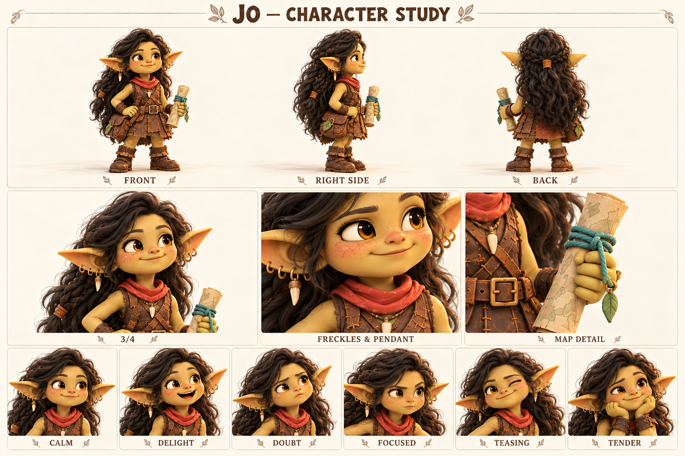

Концептуальные ракурсы и актёрские состояния. Это основа для следующего этапа моделирования; точные ортографические виды, скрытые сочленения и размеры уточняются отдельно.

### Образ

Длинные тёмно-шоколадные волнистые волосы; янтарные глаза; веснушки; кожаная туника; терракотовый платок; карта.

Палитра: Тёмный шоколад / терракота / оливковое золото / бирюзовый шнур.

### История

Jo начала рисовать карты не ради дальних стран, а чтобы объяснять знакомые места другим: где после дождя скользко, у какого корня удобно присесть, откуда слышен ручей. Её ранние схемы были больше похожи на заметки наблюдателя, чем на строгие чертежи. Шал научил её смотреть на воду, а Корень — на износ настила. Постепенно она стала тем человеком, которого спрашивают о дороге.

Однажды удобная тропа изменилась после непогоды. Jo вовремя повернула группу обратно, но долго перепроверяла, не могла ли заметить опасность раньше. Это не тайная трагедия, а источник её привычки готовиться за всех. С Тишем ей нравится лёгкость, которой самой порой не хватает; с Мирой и Уной она может быть не проводницей, а просто подругой. Длинные волосы, маленький кулон и кожаная сумка сохраняют личный образ, не заменяя его ролью «девушки с картой».

В демо она участвует в дружеской гонке и реагирует на результат, сохраняя уважение к Тишу. Победа не делает её наставницей сверху, а поражение — беспомощной. Будущая история может поставить её перед выбором между хорошо проверенным обходом и коротким путём, замеченным другим. Её рост — принять наблюдение друга и остаться собой, даже когда правильное решение пришло не от неё.

### Мотивация и характер

**Чего хочет.** Составить полезную карту троп и доводить спутников до места без неприятных сюрпризов.

**Чему нужно научиться.** Разделять ответственность и доверять чужому наблюдению, не проверяя его бесконечно.

**Чего боится.** Не заметить важную мелочь и подвести тех, кто пошёл за ней.

**Что мешает.** Иногда превращает заботу в контроль; слишком быстро предлагает своё исправление.

**На что опирается.** Внимательна, последовательна, умеет объяснить сложное через один видимый ориентир.

**Внутреннее противоречие.** Любит неизвестные места, но плохо переносит неизвестность в плане.

### Движение истории

1. Готовит маршрут за всех.
2. Неожиданность делает карту неполной.
3. Слушает наблюдение спутника и пробует его решение.
4. Добавляет на карту чужую находку с благодарностью.

### Отношения

- Тиш — близкий партнёр; их поддразнивание доброжелательное, решения остаются общими.
- Мира — вытягивает её из бесконечной подготовки в живое событие.
- Уна — помогает замечать то, что не измерить расстоянием.
- Пип и Фика — их наблюдения она принимает серьёзно, не делая детей ответственными за опасный путь.

### Характер общения

**Темп и ритм.** Ровный, уверенный; короткое наблюдение, затем понятное предложение.

**Слова и построение фразы.** Посмотри, край, след, кажется, проверим, здесь. Уточняет основание решения.

**Юмор.** Суховатая тёплая ирония и приподнятая бровь, особенно рядом с Тишем.

**Под давлением.** Становится чрезмерно точной и перечисляет лишние условия; затем учится сокращать до одного шага.

**Как проявляет заботу.** Объясняет, что именно насторожило, и оставляет собеседнику выбор.

**Чего избегать.** Не читать длинные лекции, не быть вечной правой мамой команды, не говорить за всех.

#### Примеры в сцене

**Знакомство:** Я Лума. Если идёшь к перевалу, покажу сухую тропу.

**Наблюдение:** Видишь светлый край? Этот камень качается.

**Гонка:** Договорились: кто первый — тот ждёт второго.

**Поражение:** Хороший ход. Я заметила этот проход слишком поздно.

**С Тишем:** Ты уже пошёл. Теперь давай выясним куда.

**Доверие:** Я этого не заметила. Веди, я посмотрю вместе с тобой.

### Эмоции и пластика

**CALM / Спокойствие:** Открытый внимательный взгляд, карта не заслоняет лицо.

**DELIGHT / Восторг:** Улыбка шире обычного, брови вверх, волосы следуют повороту головы.

**DOUBT / Сомнение:** Одна бровь выше, губы чуть сжаты, взгляд на предмет.

**FOCUSED / Сосредоточенность:** Взгляд устойчив, подбородок немного опущен.

**TEASING / Поддразнивание:** Небольшая улыбка одним уголком, мягкий прищур.

**TENDER / Нежность:** Лицо расслаблено, взгляд возвращается к собеседнику, без кокетливой карикатуры.

**Движение:** Перед действием коротко проверяет поверхность взглядом; убирает волосы с лица и только затем разворачивает карту. В радости может забыть сложить её аккуратно.

### Планы и ракурсы

**Общий план спереди:** Силуэт, лицо, одежда, положение ступней; без потери главных признаков.

**Боковой ракурс:** Глубина фигуры, профиль лица, предметы на ремнях и посадка одежды.

**Вид со спины:** Причёска, крепления, рюкзак либо панцирь; признаки не зеркалятся.

**Средний план в три четверти:** Лицо вместе с характерным жестом и позой корпуса.

**Крупные детали:** Материал и узнаваемые предметы; особенности лица, уха, руки или панциря.

**Шесть эмоциональных портретов:** Взгляд, брови, рот и положение головы; у существ также усики, крылья и поза.

### Будущая история

Совместная карта, на которой рядом существуют точность Jo, рисунки Фики и звуковые ориентиры Уны.

### Ограничения канона

ID остаётся luma. Не возвращать зелёную короткую косу; не путать с Рутой в шлеме. Все уши целые.

---

## Бум / Boom

Способен удержать тяжёлое и учится не держать все трудности в одиночку.

Взрослый широкоплечий друг команды; каменная правая кисть и предплечье — след спасения Пятнышка.

Внешность опирается на карту персонажей от 18 октября 2026. Развёрнутые биографии, мотивы и примеры общения — новая рабочая авторская версия. Будущие встречи не добавлены в действующий сценарий демо.

Концептуальные ракурсы и актёрские состояния. Это основа для следующего этапа моделирования; точные ортографические виды, скрытые сочленения и размеры уточняются отдельно.

### Образ

Широкий силуэт; охристый жилет; большой рюкзак; правая каменная кисть и предплечье.

Палитра: Охра / мох / речной серый / тонкие бирюзовые прожилки.

### История

Бум привык помогать там, где важны терпение и надёжность: перенести доски, придержать дверь мастерской, дождаться, пока застынет клей. Другие замечали его силу раньше аккуратности, поэтому он особенно берёг маленькие вещи. В рюкзаке всегда находилось место для мягкой подкладки, лишнего ремешка и чужой забытой чашки. Он не медленно думает — ему удобнее понятная задача, чем длинное объяснение сразу обо всём.

В рабочей будущей истории маленькая Пятнышко соскользнула в волшебную реку. Когда панцирь начал тяжелеть, Бум лёг на берег и потянулся правой рукой. Он не разжал ладонь, пока не вытащил её. Магия успела превратить кисть и предплечье в камень, но на суше изменение остановилось. Пятнышко осталась живой, а Бум — подвижным. Тонкие минеральные прожилки на обоих стали общей отметиной пережитого; история не требует изображать боль или насилие.

После этого ему пришлось заново привыкать к весу руки и осторожному захвату. Сначала он прятал неловкость, чтобы друзья не тревожились, но быстро понял: чашку проще попросить подержать, чем разбить из упрямства. В актуальном демо он доходит с командой до перевала; подробный рассказ о реке оставлен будущей главе. Его важный поступок не должен превращать каждую реплику в рассказ о собственном подвиге.

### Мотивация и характер

**Чего хочет.** Оставаться полезным другом и помочь Пятнышку освоиться с новым телом.

**Чему нужно научиться.** Принимать помощь без ощущения, что тем самым разочаровал остальных.

**Чего боится.** Нечаянно повредить хрупкое или стать для друзей только носильщиком.

**Что мешает.** Молча берёт слишком много и скрывает неудобство, пока оно не мешает делу.

**На что опирается.** Терпение, точность после тренировки, спокойствие и способность держать обещание.

**Внутреннее противоречие.** Самая тяжёлая рука в компании принадлежит самому бережному герою.

### Движение истории

1. Прячет затруднение за фразой «донесу».
2. Новая задача требует тонкости, а не силы.
3. Прямо просит помощи и учится новому хвату.
4. Поддерживает друга, не отказывая себе в поддержке.

### Отношения

- Пятнышко — спасённая подруга, а не трофей или транспорт по обязанности.
- Тиш — друг, которому Бум может честно сказать «мне неудобно».
- Jo — объясняет задачу по шагам, не разговаривая с ним как с ребёнком.
- Корень — помогает приспособить бытовые вещи; не обещает мгновенно снять магию.

### Характер общения

**Темп и ритм.** Неспешно, коротко и конкретно; пауза означает выбор слов, а не отсутствие мысли.

**Слова и построение фразы.** Держать, ровно, вместе, удобно, подожду. Один ясный вопрос за раз.

**Юмор.** Мягкая буквальность и контраст большого тела с маленькой заботой.

**Под давлением.** Говорит ещё короче; вместо громкого крика сначала обозначает действие.

**Как проявляет заботу.** Спрашивает, как удобнее помочь, а не решает за другого.

**Чего избегать.** Никаких шуток про глупость, детской речи, вечного голода и агрессии каменным кулаком.

#### Примеры в сцене

**Предложение:** Подержать ровно или просто не отпускать?

**Пятнышку:** Я рядом. Давай сначала одну лапу.

**Ошибка:** Слишком крепко взял. Попробую мягче.

**Просьба:** Эту застёжку мне пока трудно. Поможешь?

**Опасность:** Отойди на сухое. Я держу.

**Юмор:** Цветок маленький. Значит, держать надо внимательнее.

### Эмоции и пластика

**CALM / Спокойствие:** Небольшая улыбка, открытая зелёная ладонь.

**JOY / Радость:** Щёки поднимаются, смех всем корпусом, без сильного раскачивания камеры.

**WORRY / Тревога:** Брови вверх у переносицы; каменная рука остаётся устойчивой.

**RESOLVE / Решимость:** Мягкость лица сохраняется, взгляд прямо на задачу.

**SHY / Смущение:** Взгляд в сторону, плечи чуть сведены, короткая улыбка.

**RELIEF / Облегчение:** Долгий выдох и осторожное расслабление пальцев.

**Движение:** Сначала переносит вес, потом шагает. Каменная рука имеет ощутимую инерцию, но не болтается без контроля; ладонь может удержать цветок. Рюкзак следует движению с небольшой задержкой.

### Планы и ракурсы

**Общий план спереди:** Силуэт, лицо, одежда, положение ступней; без потери главных признаков.

**Боковой ракурс:** Глубина фигуры, профиль лица, предметы на ремнях и посадка одежды.

**Вид со спины:** Причёска, крепления, рюкзак либо панцирь; признаки не зеркалятся.

**Средний план в три четверти:** Лицо вместе с характерным жестом и позой корпуса.

**Крупные детали:** Материал и узнаваемые предметы; особенности лица, уха, руки или панциря.

**Шесть эмоциональных портретов:** Взгляд, брови, рот и положение головы; у существ также усики, крылья и поза.

### Будущая история

Совместное освоение переправы с Пятнышком и просьба к Корню сделать удобную застёжку.

### Ограничения канона

После реки каменная только правая кисть и предплечье ниже локтя; до реки обе руки зелёные. Не зеркалить. Магическая рука не добавляет боевых правил автоматически.

---

## Царап / Scratchy

Превращает любую встречу в игру, потому что больше всего хочет, чтобы встреча продолжилась.

Живое текстильное существо, первый новый знакомый Тиша и участник дружеской гонки.

Внешность опирается на карту персонажей от 18 октября 2026. Развёрнутые биографии, мотивы и примеры общения — новая рабочая авторская версия. Будущие встречи не добавлены в действующий сценарий демо.

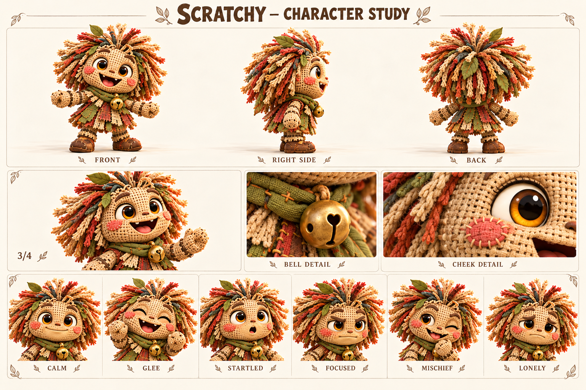

Концептуальные ракурсы и актёрские состояния. Это основа для следующего этапа моделирования; точные ортографические виды, скрытые сочленения и размеры уточняются отдельно.

### Образ

Мешковина; янтарные глаза; розовые стежки; лоскутные волосы; листья; оливковый шарф; один бубенчик.

Палитра: Крем / ржавый / олива / латунь.

### История

Царап помнит лес как последовательность звуков: сухая ветка хрустнула, шишка прокатилась, кто-то рассмеялся за кустами. Кто сшил его и как он ожил, пока остаётся открытым вопросом. В рабочей биографии он долго обитал у старой тропы, собирал потерянные лоскутки и придумывал им назначения. Заплата могла стать флажком, лист — шапкой, а две палочки — воротами для гонки.

Один латунный бубенчик на шарфе помогает ему объявлять о себе, хотя раньше он чаще выскакивал внезапно и пугал прохожих. Царап понял, что внимание легче получить шуткой, чем прямой просьбой остаться. Поэтому он предлагает ещё один забег, ещё одно правило, ещё один смешной обход. Когда остальные уходят, он иногда думает, что просто придумал недостаточно интересную игру.

В демо он зовёт Тиша из кустов, знакомится с ним и позже соревнуется на тропе. Его радость от встречи важнее результата гонки. Будущая история должна дать ему опыт обычного совместного дела: починить ограду или донести свёрток, не развлекая компанию каждую минуту. Он обнаружит, что его зовут снова даже тогда, когда он устал и тихо сидит рядом.

### Мотивация и характер

**Чего хочет.** Найти компанию, которая захочет возвращаться на его тропу.

**Чему нужно научиться.** Поверить, что дружба не требует постоянно быть забавным и полезным развлечением.

**Чего боится.** Быть забытым после того, как игра закончится.

**Что мешает.** Меняет правила на ходу и скрывает огорчение новой шуткой.

**На что опирается.** Изобретательность, открытость, умение оживить скучное дело и заметить чужое смущение.

**Внутреннее противоречие.** Громче всех зовёт играть, но тихо спрашивает, придут ли ещё.

### Движение истории

1. Знакомится через затею.
2. Слишком усложняет игру, чтобы удержать друзей.
3. Признаётся, что не хотел оставаться один.
4. Участвует в общем деле без необходимости развлекать.

### Отношения

- Тиш — первый герой текущего демо, который откликнулся на зов.
- Jo — помогает договориться о правилах заранее.
- Бум — спокойно ждёт его объяснения, не торопит.
- Дети — партнёры по придумкам; Царап не подталкивает их к опасным прогулкам.

### Характер общения

**Темп и ритм.** Пружинисто, с короткими повторами и внезапной паузой перед важной просьбой.

**Слова и построение фразы.** А давай, ещё раз, шур-шур, придумал, по-честному. Звукоподражания дозированно.

**Юмор.** Неожиданные сравнения и правила для обыденных вещей; не высмеивает слабость.

**Под давлением.** Болтает быстрее, затем замолкает, если его шутка не помогла.

**Как проявляет заботу.** Предлагает игру, в которой друг может уверенно сделать первый шаг.

**Чего избегать.** Не делать бесконечным клоуном, детской пищалкой или обманщиком ради победы.

#### Примеры в сцене

**Зов:** Эй, мастер указателей! А у тебя есть указатель на приключение?

**Предложение:** До того камня наперегонки. Правила простые. На этот раз!

**Проигрыш:** Ты первый! Я второй. Получается, оба пришли.

**Граница:** Стой. Если тебе не смешно, я перестану.

**Признание:** Я ещё игру придумал… Хотя можно просто посидеть.

**Дружба:** Завтра тоже заглянешь? Я буду здесь.

### Эмоции и пластика

**CALM / Спокойствие:** Небольшая закрытая улыбка, бубенчик неподвижен.

**GLEE / Ликование:** Открытый смех, руки вверх, лоскуты распушаются.

**STARTLED / Удивление:** Круглый рот, глаза шире, тело замирает.

**FOCUSED / Сосредоточенность:** Брови сведены, мягкие ладони держат предмет аккуратно.

**MISCHIEF / Озорство:** Один глаз прищурен, голова наклонена, улыбка без злорадства.

**LONELY / Одиночество:** Взгляд вниз, плечи опущены; не превращать в страшную заброшенную куклу.

**Движение:** Движение упругое, но ступни имеют вес. Волосы и лоскуты запаздывают за поворотом; бубенчик звенит на акценте, не непрерывно.

### Планы и ракурсы

**Общий план спереди:** Силуэт, лицо, одежда, положение ступней; без потери главных признаков.

**Боковой ракурс:** Глубина фигуры, профиль лица, предметы на ремнях и посадка одежды.

**Вид со спины:** Причёска, крепления, рюкзак либо панцирь; признаки не зеркалятся.

**Средний план в три четверти:** Лицо вместе с характерным жестом и позой корпуса.

**Крупные детали:** Материал и узнаваемые предметы; особенности лица, уха, руки или панциря.

**Шесть эмоциональных портретов:** Взгляд, брови, рот и положение головы; у существ также усики, крылья и поза.

### Будущая история

История о тихой дружбе и поиске происхождения нескольких заплат без обязательного раскрытия создателя.

### Ограничения канона

Одна личность во всех видах; один бубенчик. Не добавлять гоблинские уши или кожу. Происхождение оживления остаётся открытым.

---

## Пип / Pip

Хочет первым сделать открытие и учится отличать догадку от того, что действительно увидел.

Ребёнок, племянник Тиша; деятельная половина пары Пип–Фика.

Внешность опирается на карту персонажей от 18 октября 2026. Развёрнутые биографии, мотивы и примеры общения — новая рабочая авторская версия. Будущие встречи не добавлены в действующий сценарий демо.

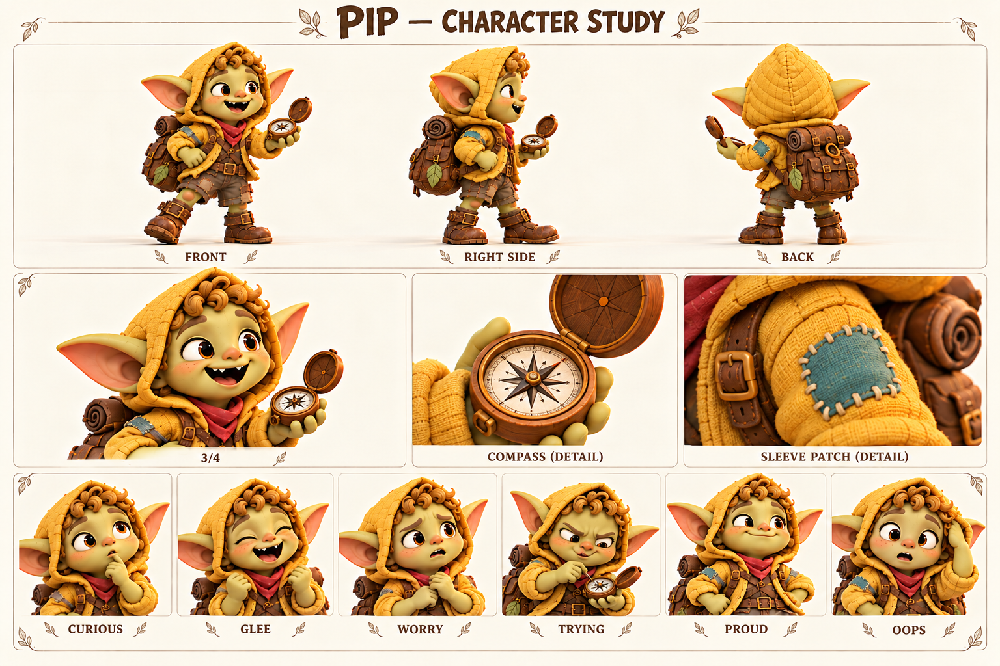

Концептуальные ракурсы и актёрские состояния. Это основа для следующего этапа моделирования; точные ортографические виды, скрытые сочленения и размеры уточняются отдельно.

### Образ

Медно-золотые кудри; шафрановый капюшон; бирюзовая заплата; компас.

Палитра: Шафран / мёд / бирюза.

### История

Пип знает деревню по местам, где можно что-нибудь обнаружить: под ступенькой, за корзиной, возле мастерской. Ему нравится приносить взрослым находки, даже если это уже знакомая всем гайка. Тиш для него — человек, который уходит по тропе и возвращается с историей. Пип пытается повторить эту уверенность в безопасных маленьких исследованиях у дома.

Компас стал его первым настоящим инструментом. Корень помог понять, почему стрелка не обязана указывать на то, что хочется найти. Но Пип по-прежнему иногда объявляет направление раньше, чем дождался её остановки. Однажды он уверенно повёл Фику к «неизвестному ручью», который оказался канавкой после дождя. Ему было стыдно, пока Фика не нарисовала там целую карту для жуков: ошибка тоже могла стать открытием, если назвать её честно.

В дальнейшем он может получить небольшое настоящее поручение — отметить сухую дорожку между домами или проверить указатель вместе со взрослым. Важна не награда за смелость в опасности, а опыт доведённой до конца проверки. Пип остаётся ребёнком, которому разрешено шумно радоваться, ошибаться и просить объяснение. Он не должен отвечать за спасение взрослых или тайком проходить опасный маршрут.

### Мотивация и характер

**Чего хочет.** Получить настоящее поручение и быть услышанным, когда сообщает находку.

**Чему нужно научиться.** Научиться останавливаться, проверять и признавать вклад Фики.

**Чего боится.** Что его будут считать слишком маленьким и не станут слушать.

**Что мешает.** Называет первую догадку фактом и перебивает от нетерпения.

**На что опирается.** Энергия, любопытство, готовность пробовать и радоваться чужому успеху, когда вспомнит оглядеться.

**Внутреннее противоречие.** Хочет выглядеть опытным, но задаёт самые прямые и полезные вопросы.

### Движение истории

1. Громко объявляет открытие.
2. Обнаруживает, что поспешил.
3. Перепроверяет с Фикой и признаёт ошибку.
4. Сам уточняет: «Это я увидел, а это пока думаю».

### Отношения

- Тиш — любимый дядя, которому хочется подражать.
- Фика — партнёр по открытиям, а не тихая помощница.
- Корень — объясняет инструмент без насмешки.
- Бум — большой друг, рядом с которым можно задавать простые вопросы.

### Характер общения

**Темп и ритм.** Быстрые короткие фразы, вопрос часто появляется раньше конца предыдущей мысли.

**Слова и построение фразы.** Смотри, нашёл, настоящий, а почему, почти. Простые конкретные слова.

**Юмор.** Буквальные выводы и чрезмерно серьёзное отношение к маленькой находке.

**Под давлением.** Сначала оправдывается, потом честно признаётся одной короткой фразой.

**Как проявляет заботу.** Зовёт другого посмотреть и делится найденным.

**Чего избегать.** Не использовать лепет, взрослую саркастичность, постоянную глупость или образ непослушного наказуемого ребёнка.

#### Примеры в сцене

**Находка:** Смотрите! След! Я ещё не знаю чей, но уже нашёл.

**С Фикой:** Я заметил лужу. А Фика заметила, что это не река.

**Вопрос:** Если север там, почему домой сюда?

**Ошибка:** Я сказал слишком рано. Давайте проверим.

**Поручение:** Настоящее? И потом показать, что получилось?

**Забота:** Подожди, я тебе тоже оставил место посмотреть.

### Эмоции и пластика

**CURIOUS / Любопытство:** Глаза вверх к предмету, приоткрытый рот.

**GLEE / Ликование:** Кулаки у груди, открытый смех.

**WORRY / Тревога:** Сжимает компас, ищет взрослого взглядом.

**TRYING / Старание:** Хмурит брови над инструментом, высовывать язык необязательно.

**PROUD / Гордость:** Выпрямляется, подбородок чуть вверх, улыбка огромная.

**OOPS / Ой:** Замирает, глаза круглые, ладонь к капюшону.

**Движение:** Короткие быстрые шаги, запоздалая остановка корпуса; во время проверки намеренно удерживает обе ступни на месте.

### Планы и ракурсы

**Общий план спереди:** Силуэт, лицо, одежда, положение ступней; без потери главных признаков.

**Боковой ракурс:** Глубина фигуры, профиль лица, предметы на ремнях и посадка одежды.

**Вид со спины:** Причёска, крепления, рюкзак либо панцирь; признаки не зеркалятся.

**Средний план в три четверти:** Лицо вместе с характерным жестом и позой корпуса.

**Крупные детали:** Материал и узнаваемые предметы; особенности лица, уха, руки или панциря.

**Шесть эмоциональных портретов:** Взгляд, брови, рот и положение головы; у существ также усики, крылья и поза.

### Будущая история

Первое полезное поручение у деревни, выполненное вместе с Фикой.

### Ограничения канона

Детский силуэт, целые уши, компас не волшебный. Не отправлять одного в опасность.

---

## Фика / Fika

Замечает то, мимо чего пробегают другие, и учится показывать незаконченные мысли.

Ребёнок, племянница Тиша; наблюдательница и рисовальщица в паре с Пипом.

Внешность опирается на карту персонажей от 18 октября 2026. Развёрнутые биографии, мотивы и примеры общения — новая рабочая авторская версия. Будущие встречи не добавлены в действующий сценарий демо.

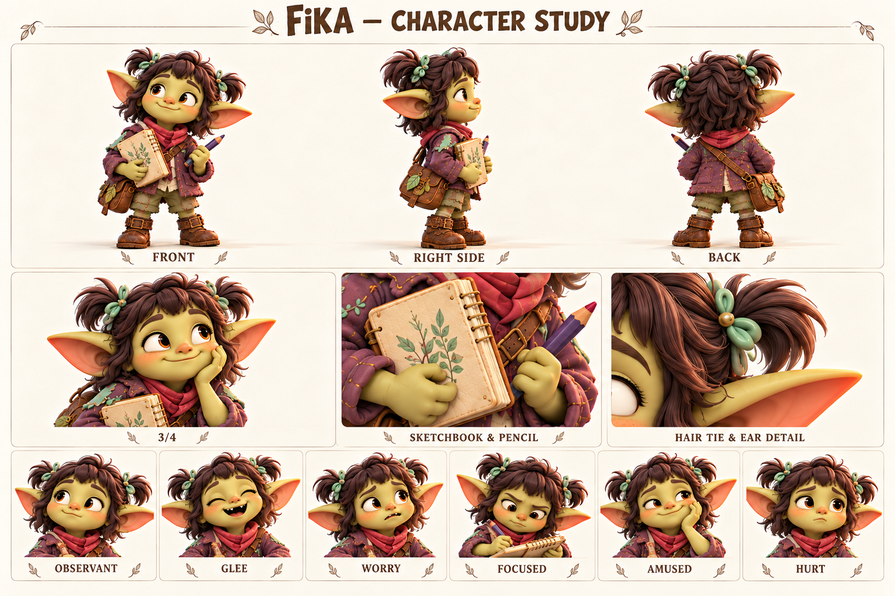

Концептуальные ракурсы и актёрские состояния. Это основа для следующего этапа моделирования; точные ортографические виды, скрытые сочленения и размеры уточняются отдельно.

### Образ

Сливово-каштановое каре с двумя хвостиками; мятные завязки; сливовая куртка; альбом.

Палитра: Слива / мята / крем.

### История

Фика начала рисовать, чтобы не потерять увиденное: форму листа, смешную складку на лице Корня, лапки жука на краю ступеньки. В альбоме рядом живут точные наблюдения и выдуманные подписи. Ей нравится, когда рисунок помогает другому увидеть ту же деталь. Она не молчит из-за отсутствия идей — иногда идей слишком много, и она выбирает, с какой начать.

Пип часто успевает громко объявить находку, пока Фика ещё подбирает слова. Ей бывает обидно, но вместо спора она уходит исправлять рисунок. Однажды Jo попросила показать незаконченный набросок, и именно неровная линия оказалась полезной: на ней была отмечена треснувшая ступенька. Фика впервые увидела, что рисунок может быть ценным до того, как станет красивым.

Её будущий шаг — попросить время для собственной истории, а не ждать, пока её заметят. Она может сделать деревенский альбом троп, где оставит место и чужим рисункам. Это даст ей право ошибаться, смеяться и быть громкой в подходящий момент. Важно сохранять её озорство: она умеет нарисовать смешной нос дяди и первой засмеяться над своей кляксой.

### Мотивация и характер

**Чего хочет.** Чтобы её наблюдения и рисунки действительно помогали другим.

**Чему нужно научиться.** Говорить о своём вкладе и делиться незавершённым, не дожидаясь идеального результата.

**Чего боится.** Что над её рисунком посмеются или не дадут договорить.

**Что мешает.** Молча обижается и прячет работу, вместо того чтобы объяснить, что ей важно.

**На что опирается.** Внимательность к деталям, образная память, терпение и тонкий юмор.

**Внутреннее противоречие.** Смело придумывает на бумаге, но осторожничает, когда нужно показать лист.

### Движение истории

1. Сохраняет наблюдение только в альбоме.
2. Её молчание мешает совместному делу.
3. Показывает сырой рисунок и говорит первой.
4. Приглашает другого дорисовать рядом.

### Отношения

- Пип — любимый партнёр, с которым можно и спорить, и мириться.
- Тиш — дядя, который учится не отвечать за неё.
- Jo — принимает наброски как полезные сведения.
- Уна — умеет выдержать паузу, пока Фика подбирает слова.

### Характер общения

**Темп и ритм.** Небольшая пауза перед точным замечанием; в знакомой компании речь становится живее.

**Слова и построение фразы.** Я заметила, вот здесь, похоже, можно покажу. Детские, но ясные сравнения.

**Юмор.** Точная смешная деталь и неожиданная подпись к рисунку.

**Под давлением.** Голос тише, фразы обрываются; взросление — прямое «я ещё не закончила говорить».

**Как проявляет заботу.** Показывает, что запомнила личную мелочь о друге.

**Чего избегать.** Не делать безэмоциональным гением, вечной исправительницей Пипа или взрослым психологом.

#### Примеры в сцене

**Наблюдение:** У всех следов носки туда. А у этого — обратно.

**Просьба:** Можно я сначала покажу? Так понятнее.

**Граница:** Пип, это моя находка. Дай я расскажу.

**Юмор:** Это не клякса. Это Бум издалека. Ладно, клякса.

**Сомнение:** Не очень ровно получилось. Но место вот здесь.

**Доверие:** Хочешь дорисовать? Только оставь место моему жуку.

### Эмоции и пластика

**OBSERVANT / Наблюдение:** Взгляд в сторону детали, спокойный рот.

**GLEE / Радость:** Смеётся открыто, альбом прижат локтем.

**WORRY / Тревога:** Брови приподняты, карандаш остановлен.

**FOCUSED / Сосредоточенность:** Смотрит вниз на лист, плечи собраны без напряжения.

**AMUSED / Веселье:** Небольшой хитрый прищур и улыбка.

**HURT / Обида:** Губы сжаты, взгляд отведён; без постоянных слёз.

**Движение:** Сначала смотрит, затем наклоняет голову и рисует; при волнении закрывает альбом ладонью, при доверии разворачивает его к собеседнику.

### Планы и ракурсы

**Общий план спереди:** Силуэт, лицо, одежда, положение ступней; без потери главных признаков.

**Боковой ракурс:** Глубина фигуры, профиль лица, предметы на ремнях и посадка одежды.

**Вид со спины:** Причёска, крепления, рюкзак либо панцирь; признаки не зеркалятся.

**Средний план в три четверти:** Лицо вместе с характерным жестом и позой корпуса.

**Крупные детали:** Материал и узнаваемые предметы; особенности лица, уха, руки или панциря.

**Шесть эмоциональных портретов:** Взгляд, брови, рот и положение головы; у существ также усики, крылья и поза.

### Будущая история

Общий альбом деревни с местом для чужих несовершенных рисунков.

### Ограничения канона

Детские пропорции; сливовые волосы и мятные завязки; целые уши. Не задавать точный возраст как утверждённый канон.

---

## Мира / Mira

Умеет находить место для каждого и учится оставлять место для себя.

Взрослая жительница деревни, подруга Jo и Уны, устроительница общих праздников.

Внешность опирается на карту персонажей от 18 октября 2026. Развёрнутые биографии, мотивы и примеры общения — новая рабочая авторская версия. Будущие встречи не добавлены в действующий сценарий демо.

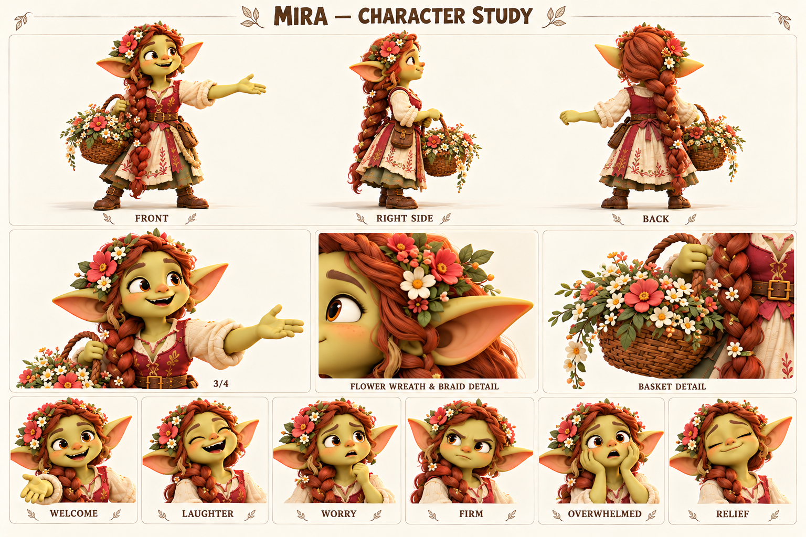

Концептуальные ракурсы и актёрские состояния. Это основа для следующего этапа моделирования; точные ортографические виды, скрытые сочленения и размеры уточняются отдельно.

### Образ

Длинная толстая медная коса; ягодный жилет; асимметричный венок; корзина.

Палитра: Медь / ягода / коралл / крем.

### История

Мира привыкла собирать людей вокруг простых вещей: свежих цветов, длинного стола, истории, которую лучше слушать вместе. Она хорошо помнит, кто любит сидеть в тени, кому нужен стул повыше, кто стесняется прийти без приглашения. Её корзина — рабочий инструмент, а не только украшение: в ней цветы, ленты и мелочи, которые помогают месту стать гостеприимным.

Со временем жители стали обращаться к ней всякий раз, когда требовалось что-то устроить. Мире нравилось доверие, но она начала отвечать «конечно» даже тогда, когда уже не успевала. Однажды небольшой вечер у дома вырос в целую подготовку, и она пропустила любимую песню Уны, потому что всё ещё поправляла гирлянду. После этого Уна стала звать её не помогать, а слушать — приглашение, которое Мире оказалось непросто принять.

В будущей истории Мира может подготовить встречу путешественников, а дождь изменит все планы. Её обычная реакция — удвоить усилия и раздать поручения. Настоящий поворот наступит, когда она скажет, что не справляется одна, и позволит другим сделать по-своему. Праздник получится менее ровным, но она впервые останется на нём участницей, а не обслуживающей силой.

### Мотивация и характер

**Чего хочет.** Создавать места, где никто не чувствует себя лишним.

**Чему нужно научиться.** Признавать собственную усталость и принимать несовершенную помощь.

**Чего боится.** Что без её постоянной работы люди разойдутся или кто-то останется забытым.

**Что мешает.** Берёт чужие задачи, контролирует детали и может отвечать за человека, которого хочет включить.

**На что опирается.** Социальная наблюдательность, щедрость, организованность и заразительное тепло.

**Внутреннее противоречие.** Легко приглашает всех к столу, но сама всё время стоит рядом с ним.

### Движение истории

1. Собирает событие на собственных усилиях.
2. Планы срываются, а сил уже нет.
3. Просит конкретную помощь и перестаёт всё поправлять.
4. Садится рядом с друзьями и принимает заботу.

### Отношения

- Jo — близкая подруга, с которой обе могут спорить о чрезмерной подготовке.
- Уна — замечает усталость Миры до её признания.
- Дети — получают посильные добровольные поручения, а не роль бесплатных помощников.
- Рута — будущая гостья, которую Мира учится приглашать без требований задержаться.

### Характер общения

**Темп и ритм.** Тёплая энергичная речь, легко называет собеседника по имени.

**Слова и построение фразы.** Заходи, найдём, вместе, кому удобно, осталось одно. Любит конкретные приглашения.

**Юмор.** Добрые наблюдения о подготовке и маленьком хаосе, без колких оценок внешности.

**Под давлением.** Слишком бодрый голос и длинный список дел; усталость слышно в короткой тишине.

**Как проявляет заботу.** Замечает потребность человека и предлагает выбор места или участия.

**Чего избегать.** Не сводить к свахе, сплетнице или безотказной обслуживающей подруге.

#### Примеры в сцене

**Приглашение:** Заходи. Место уже есть, стул сейчас найдём.

**С Уной:** Сыграй ещё раз. В этот раз я сяду и послушаю.

**Поручение:** Поможешь с цветами? Если хочется, конечно.

**Перегрузка:** Я сказала «ещё одно» уже пять раз. Мне нужна помощь.

**Граница:** Сегодня я не успею. Давай придумаем вместе.

**Радость:** Неровно вышло. Зато все здесь.

### Эмоции и пластика

**WELCOME / Приветствие:** Открытая ладонь, взгляд прямо к гостю.

**LAUGHTER / Смех:** Плечи двигаются свободно, глаза щурятся.

**WORRY / Тревога:** Брови вверх, взгляд быстро ищет недостающее.

**FIRM / Твёрдость:** Улыбка исчезает, ладонь останавливает без угрозы.

**OVERWHELMED / Перегрузка:** Пауза, широко открытые глаза, руки на мгновение пусты.

**RELIEF / Облегчение:** Выдох и спокойная улыбка, корзина опущена.

**Движение:** Широкий приветственный жест, уверенное обращение с корзиной; в усталости движения мельчают, коса тяжело следует за поворотом.

### Планы и ракурсы

**Общий план спереди:** Силуэт, лицо, одежда, положение ступней; без потери главных признаков.

**Боковой ракурс:** Глубина фигуры, профиль лица, предметы на ремнях и посадка одежды.

**Вид со спины:** Причёска, крепления, рюкзак либо панцирь; признаки не зеркалятся.

**Средний план в три четверти:** Лицо вместе с характерным жестом и позой корпуса.

**Крупные детали:** Материал и узнаваемые предметы; особенности лица, уха, руки или панциря.

**Шесть эмоциональных портретов:** Взгляд, брови, рот и положение головы; у существ также усики, крылья и поза.

### Будущая история

Праздник, который спасает не идеальный порядок, а участие всех.

### Ограничения канона

Медная длинная коса и ягодный цвет, целые уши. Не копировать волосы Jo и не возвращать одинаковые зелёные причёски подруг.

---

## Уна / Una

Слышит настроение места и учится быть услышанной самой.

Взрослая музыкантка, подруга Jo и Миры; внимательная слушательница со своим мнением.

Внешность опирается на карту персонажей от 18 октября 2026. Развёрнутые биографии, мотивы и примеры общения — новая рабочая авторская версия. Будущие встречи не добавлены в действующий сценарий демо.

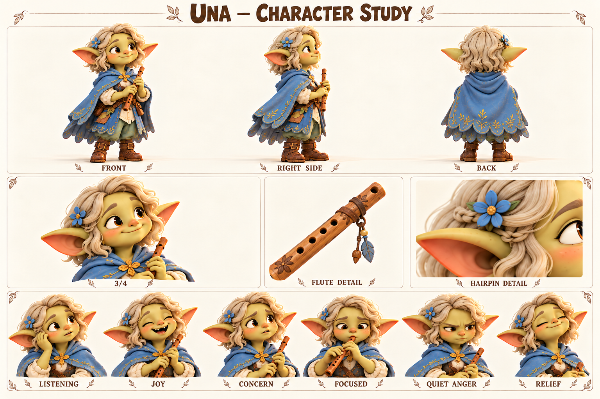

Концептуальные ракурсы и актёрские состояния. Это основа для следующего этапа моделирования; точные ортографические виды, скрытые сочленения и размеры уточняются отдельно.

### Образ

Пепельно-пшеничные короткие волны; маленькая косичка; небесная накидка; свирель.

Палитра: Светлая пшеница / небесный / индиго.

### История

Уна запоминает дорогу по звукам: вода под мостком, скрип верёвки, два удара ставни на ветру. Игра на свирели выросла из попыток повторить эти маленькие ритмы. Она не считает музыку особой магией; для неё это способ заметить знакомое заново. Шал иногда узнаёт по её мелодии, какой участок реки она слушала.

Людям рядом с Уной легко говорить, потому что она не торопит с ответом. Постепенно её стали считать всегда согласной. На общих встречах она играла то, что просили, даже когда принесла новую собственную мелодию. Мира первой заметила, что свирель уже убрана, а Уна ещё хотела что-то сказать. Их дружба держится не только на поддержке: Уна умеет мягко, но прямо остановить Мирину привычку всё организовывать.

Будущий сюжет может начаться с разногласия о шумном празднике или маршруте вдоль реки. Уна услышит изменение привычного звука и предложит остановиться, но её тихая фраза потеряется. Её задача — повторить важное твёрдо, не превращаясь в другого человека. Она останется спокойной, а её голос приобретёт вес. Свирель помогает выразить эмоцию, но не заменяет прямое «нет».

### Мотивация и характер

**Чего хочет.** Сохранить звуки знакомых мест и делиться собственной музыкой.

**Чему нужно научиться.** Высказывать желания и несогласие до того, как молчание превратится в обиду.

**Чего боится.** Что громкий спор разрушит близость или что её песня никому не нужна.

**Что мешает.** Слишком долго уступает, ожидая, что другие догадаются сами.

**На что опирается.** Внимание, эмоциональная точность, терпение и способность заметить изменение обстановки.

**Внутреннее противоречие.** Помогает другим выговориться, а собственную просьбу откладывает.

### Движение истории

1. Соглашается ради общего спокойствия.
2. Замечает важное и остаётся неуслышанной.
3. Повторяет просьбу ясно и твёрдо.
4. Предлагает свою мелодию, не спрашивая заранее, достаточно ли она хороша.

### Отношения

- Мира — близкая подруга, которой Уна может честно сказать «остановись».
- Jo — ценит её звуковые ориентиры, хотя не всё помещается на карту.
- Фика — получает от неё время договорить.
- Шал — разделяет внимание к реке, но не знает все её ответы.

### Характер общения

**Темп и ритм.** Ровный, с осмысленными паузами; предложения короткие, но не загадочные.

**Слова и построение фразы.** Слышишь, подожди, мне хочется, тише, вместе. Образные слова редко и к месту.

**Юмор.** Негромкое точное замечание, сказанное в удачный момент.

**Под давлением.** Сначала замолкает; решимость проявляется ясной фразой без повышения голоса.

**Как проявляет заботу.** Остаётся рядом и спрашивает, нужно ли сейчас говорить.

**Чего избегать.** Не делать мистическим оракулом, бесконечно печальной девушкой или человеком без границ.

#### Примеры в сцене

**Наблюдение:** Подожди. Обычно вода здесь звучит иначе.

**Приглашение:** Можно сыграю новую? Она пока короткая.

**С Мирой:** Цветы уже красивые. Сядь со мной.

**Граница:** Я не согласна. Дай мне объяснить.

**Поддержка:** Можно ничего не рассказывать. Я посижу рядом.

**Юмор:** Пип попал в ритм. Просто в свой.

### Эмоции и пластика

**LISTENING / Слушание:** Голова чуть наклонена, глаза открыты.

**JOY / Радость:** Тёплая улыбка, взгляд поднимается.

**CONCERN / Забота:** Брови мягко собраны, лицо обращено к другу.

**FOCUSED / Сосредоточенность:** Пальцы спокойно лежат на свирели, дыхание ровное.

**QUIET ANGER / Тихая злость:** Сжатые губы, прямой взгляд, неподвижная поза.

**RELIEF / Облегчение:** Плечи расслабляются, улыбка возвращается постепенно.

**Движение:** Маленькие точные жесты. Перед игрой слышен спокойный вдох; при несогласии она опускает инструмент и смотрит прямо.

### Планы и ракурсы

**Общий план спереди:** Силуэт, лицо, одежда, положение ступней; без потери главных признаков.

**Боковой ракурс:** Глубина фигуры, профиль лица, предметы на ремнях и посадка одежды.

**Вид со спины:** Причёска, крепления, рюкзак либо панцирь; признаки не зеркалятся.

**Средний план в три четверти:** Лицо вместе с характерным жестом и позой корпуса.

**Крупные детали:** Материал и узнаваемые предметы; особенности лица, уха, руки или панциря.

**Шесть эмоциональных портретов:** Взгляд, брови, рот и положение головы; у существ также усики, крылья и поза.

### Будущая история

Собственная песня деревни, в которой каждый узнает свой небольшой звук.

### Ограничения канона

Светлые короткие волны, голубая накидка, целые уши. Музыка пока не управляет магией или игровыми правилами.

---

## Корень / Koren

Помнит, как сделана каждая вещь, и учится доверять тем, кто сделает следующую.

Пожилой ремесленник деревни; наставник, который тоже учится отпускать привычный порядок.

Внешность опирается на карту персонажей от 18 октября 2026. Развёрнутые биографии, мотивы и примеры общения — новая рабочая авторская версия. Будущие встречи не добавлены в действующий сценарий демо.

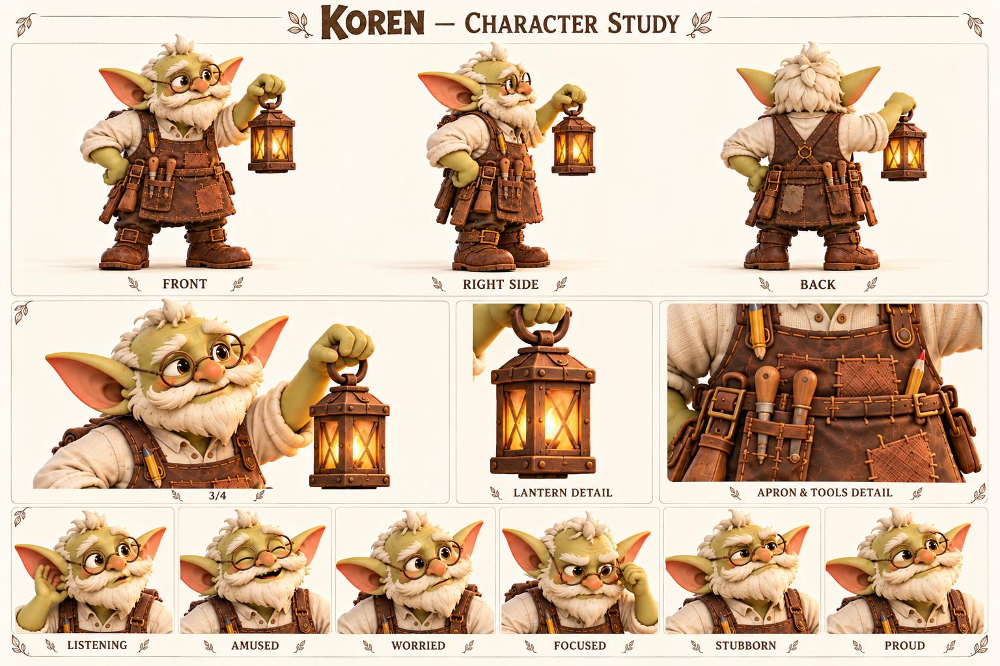

Концептуальные ракурсы и актёрские состояния. Это основа для следующего этапа моделирования; точные ортографические виды, скрытые сочленения и размеры уточняются отдельно.

### Образ

Кремовые усы веером; белый хохолок; круглые очки; рыжевато-коричневый фартук; фонарь.

Палитра: Крем / ржавый / янтарь.

### История

Корень большую часть жизни чинил то, что связывает деревню: дверные петли, перила, фонари, колёса тележек. Он узнаёт свои старые работы по едва заметной зарубке и может рассказать, почему выбрал именно эту доску. Для него ремонт — продолжение знакомства с хозяином вещи. Поэтому выброшенная сломанная ручка иногда расстраивает его сильнее, чем большая новая работа радует.

Он привык отвечать за результат и незаметно превратился в человека, который поправляет чужую руку над инструментом прежде, чем ученик успел попробовать. Тиш приносит ему задачи слишком поздно, Пип задаёт слишком много вопросов, а Фика рисует конструкцию не так, как он объяснял. Все трое его утомляют и радуют. С Шалом Корень спорит о старых мостках: один помнит крепёж, другой — воду под ним.

Будущая история может потребовать приспособить застёжку для каменной руки Бума. Старый привычный способ не подойдёт, и Корню придётся сначала спросить, что Буму удобно. Успехом станет не чудесное исцеление, а совместно найденная простая вещь. В конце Корень оставит на столе инструмент для следующего мастера и удержится от последней поправки.

### Мотивация и характер

**Чего хочет.** Чтобы вещи служили долго и его знания оставались полезными.

**Чему нужно научиться.** Спрашивать о потребности и доверять чужому способу работы.

**Чего боится.** Стать ненужным или увидеть, как важное мастерство исчезает.

**Что мешает.** Объясняет слишком долго и исправляет прежде, чем его попросили.

**На что опирается.** Практическая память, терпение, точные руки и уважение к небольшим вещам.

**Внутреннее противоречие.** Прекрасно чинит старое, но не сразу замечает, что новому нужна другая форма.

### Движение истории

1. Предлагает проверенный способ.
2. Видит, что он неудобен конкретному другу.
3. Слушает и пробует совместное решение.
4. Передаёт инструмент и оставляет право на ошибку.

### Отношения

- Тиш — деятельный ученик без официального ученичества.
- Пип и Фика — вопросы и рисунки заставляют объяснять проще.
- Бум — партнёр по поиску удобного решения, не объект ремонта.
- Шал — старый знакомый с другой памятью о тех же местах.

### Характер общения

**Темп и ритм.** Спокойный, чуть обстоятельный; умеет сократить объяснение, когда замечает усталость.

**Слова и построение фразы.** Примерим, держится, послужит, ровно, попробуй сам. Ремесленные сравнения по делу.

**Юмор.** Тёплое ворчание на вещи и собственные привычки, а не на молодёжь.

**Под давлением.** Уходит в технические подробности; смягчается, когда задаёт конкретный вопрос.

**Как проявляет заботу.** Делает удобнее и учится сначала спрашивать разрешение помочь.

**Чего избегать.** Не всезнающий мудрец, не ходячая мораль, не магический целитель любой проблемы.

#### Примеры в сцене

**Работа:** Починить можно. Сначала скажи, как ты этим пользуешься.

**С Бумом:** Не руку под застёжку. Застёжку под руку.

**С детьми:** Вот инструмент. Попробуй. Я подержу доску.

**Ошибка:** Старый способ. Для этой задачи — не лучший.

**Юмор:** Очки искал. Через очки. Бывает.

**Передача:** Теперь твоя очередь. Я не буду поправлять. Постараюсь.

### Эмоции и пластика

**LISTENING / Слушание:** Смотрит поверх очков, голова чуть вперёд.

**AMUSED / Веселье:** Усы поднимаются, глаза улыбаются.

**WORRIED / Беспокойство:** Брови вверх, рука замирает над инструментом.

**FOCUSED / Сосредоточенность:** Очки поправлены, взгляд точный.

**STUBBORN / Упрямство:** Подбородок вверх, губы скрыты усами, плечи собраны.

**PROUD / Гордость:** Тихая улыбка, взгляд направлен на чужую работу.

**Движение:** Экономные точные движения, привычка проверять соединение пальцем. Не трясётся постоянно; возраст выражен темпом и посадкой.

### Планы и ракурсы

**Общий план спереди:** Силуэт, лицо, одежда, положение ступней; без потери главных признаков.

**Боковой ракурс:** Глубина фигуры, профиль лица, предметы на ремнях и посадка одежды.

**Вид со спины:** Причёска, крепления, рюкзак либо панцирь; признаки не зеркалятся.

**Средний план в три четверти:** Лицо вместе с характерным жестом и позой корпуса.

**Крупные детали:** Материал и узнаваемые предметы; особенности лица, уха, руки или панциря.

**Шесть эмоциональных портретов:** Взгляд, брови, рот и положение головы; у существ также усики, крылья и поза.

### Будущая история

Совместная работа над удобной застёжкой для Бума и первое самостоятельное изделие племянников.

### Ограничения канона

Кремовые усы, круглые очки, фартук и целые уши. Фонарь не требует возвращать сюжет линзы.

---

## Шал / Shal

Не спорит с течением, но должен научиться вовремя говорить людям о том, что заметил.

Старший гоблин-паромщик, знаток местных переправ и давний знакомый Корня.

Внешность опирается на карту персонажей от 18 октября 2026. Развёрнутые биографии, мотивы и примеры общения — новая рабочая авторская версия. Будущие встречи не добавлены в действующий сценарий демо.

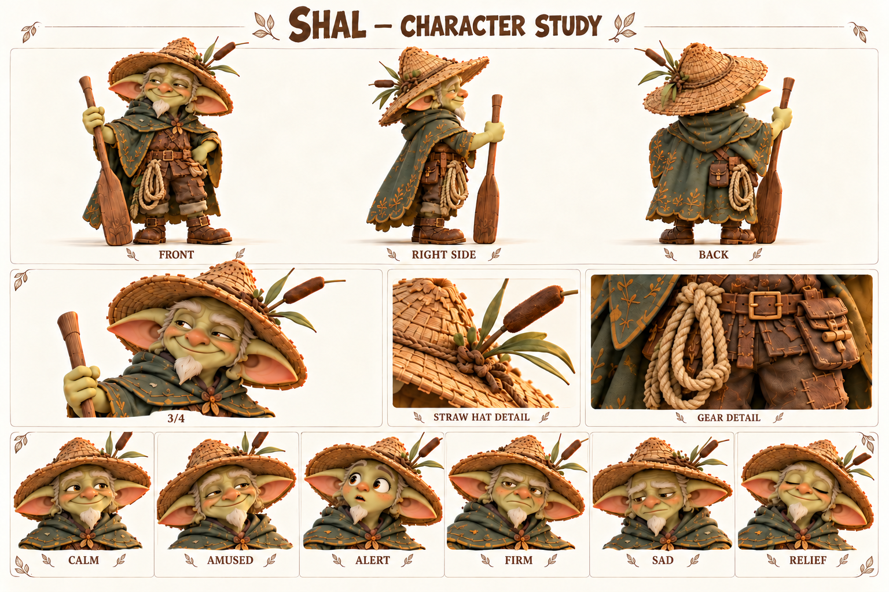

Концептуальные ракурсы и актёрские состояния. Это основа для следующего этапа моделирования; точные ортографические виды, скрытые сочленения и размеры уточняются отдельно.

### Образ

Соломенная шляпа; узкая седая бородка; зелёный плащ; верёвка; весло.

Палитра: Солома / лесной зелёный / охра.

### История

Шал много лет переводит жителей и грузы через реку. Его знание состоит из повторений: где вода темнеет после дождя, когда меняется натяжение верёвки, какой звук издаёт пустое весло о настил. Он уважает реку не как загадочную волю, а как силу, которую полезно наблюдать каждый день. Шляпа, плащ и верёвка у него потёрты работой, а не приключенческой позой.

Однажды после непогоды Шал отложил привычную переправу и повёл людей длинным сухим обходом. Все благополучно добрались, но он долго вспоминал недовольство тех, кому не объяснил причину задержки. Ему казалось, что достаточно сказать «сегодня нельзя». С тех пор он старается показывать видимый знак, хотя порой всё ещё ждёт, что окружающие сами заметят очевидное для него.

В будущей речной истории Шал может помочь понять, где прекращается действие воды и как безопасно подойти к берегу. Он не знает заранее всей природы превращения и не обесценивает поступок Бума фразой «я же говорил». Его собственная задача — объяснить вовремя и принять помощь на знакомой переправе, когда привычный порядок перестаёт работать.

### Мотивация и характер

**Чего хочет.** Чтобы каждый переход через реку заканчивался возвращением на твёрдую землю.

**Чему нужно научиться.** Делиться наблюдениями прямо, а не заменять объяснение авторитетом и молчанием.

**Чего боится.** Пропустить изменение знакомой реки из-за самоуверенности.

**Что мешает.** Иногда слишком долго наблюдает и не сообщает остальным, что его тревожит.

**На что опирается.** Выдержка, знание местности, практические навыки и отсутствие показной храбрости.

**Внутреннее противоречие.** Неподвижный на вид человек всё время следит за переменами.

### Движение истории

1. Полагается на привычный ритм.
2. Река меняет условия.
3. Показывает команде признаки и спрашивает их наблюдения.
4. Ведёт переправу как общее дело.

### Отношения

- Корень — старый товарищ по мосткам; спорят о деталях, доверяют в деле.
- Jo — уважает его наблюдения и просит объяснять основания.
- Уна — слышит изменения, которые он замечает по воде.
- Бум — получает практическую поддержку без обвинения за риск.

### Характер общения

**Темп и ритм.** Медленный, но ясный. Пауза нужна для наблюдения, не для таинственности.

**Слова и построение фразы.** Берег, держи, течение, сейчас, подождём. Конкретные знаки вместо пророчеств.

**Юмор.** Сухое короткое замечание после суеты окружающих.

**Под давлением.** Переходит на точные команды с именем адресата.

**Как проявляет заботу.** Объясняет следующий безопасный шаг и остаётся последним у края.

**Чего избегать.** Не говорить загадками в каждой реплике, не предсказывать всё и не читать мораль после спасения.

#### Примеры в сцене

**Наблюдение:** Верёвка натянулась иначе. Подождём и посмотрим.

**Указание:** Тиш, на сухую доску. Бум, держи этот конец.

**Объяснение:** Не потому, что я старше. Видишь, вода закрыла нижнюю метку?

**С Уной:** Да. Вчера под мостком звучало тише.

**Юмор:** Река спешит. Нам незачем.

**Доверие:** Я смотрю на воду. Ты посмотри на крепление.

### Эмоции и пластика

**CALM / Покой:** Расслабленные плечи, взгляд вдаль.

**AMUSED / Веселье:** Небольшая улыбка одним уголком.

**ALERT / Настороженность:** Взгляд фиксируется, рука плотнее держит весло.

**FIRM / Твёрдость:** Прямой взгляд и короткий останавливающий жест.

**SAD / Грусть:** Голова чуть опущена, взгляд задерживается на знакомом месте.

**RELIEF / Облегчение:** Хват ослабевает, возвращается лёгкая улыбка.

**Движение:** Сначала переставляет опору, затем переносит вес; проверяет узел большим пальцем. Весло служит инструментом, а не посохом волшебника.

### Планы и ракурсы

**Общий план спереди:** Силуэт, лицо, одежда, положение ступней; без потери главных признаков.

**Боковой ракурс:** Глубина фигуры, профиль лица, предметы на ремнях и посадка одежды.

**Вид со спины:** Причёска, крепления, рюкзак либо панцирь; признаки не зеркалятся.

**Средний план в три четверти:** Лицо вместе с характерным жестом и позой корпуса.

**Крупные детали:** Материал и узнаваемые предметы; особенности лица, уха, руки или панциря.

**Шесть эмоциональных портретов:** Взгляд, брови, рот и положение головы; у существ также усики, крылья и поза.

### Будущая история

Переправа с новым тяжёлым пассажиром, где знания Шала дополняются наблюдениями друзей.

### Ограничения канона

Соломенная шляпа, узкая седая бородка, целые уши. Не путать с Корнем и не объяснять всю магию реки одним монологом.

---

## Рыж / Ryzh

Хочет, чтобы его замечали первым, и учится оставаться заметным после поражения.

Взрослый гоблин-гонщик, дружеский соперник и возможный будущий союзник.

Внешность опирается на карту персонажей от 18 октября 2026. Развёрнутые биографии, мотивы и примеры общения — новая рабочая авторская версия. Будущие встречи не добавлены в действующий сценарий демо.

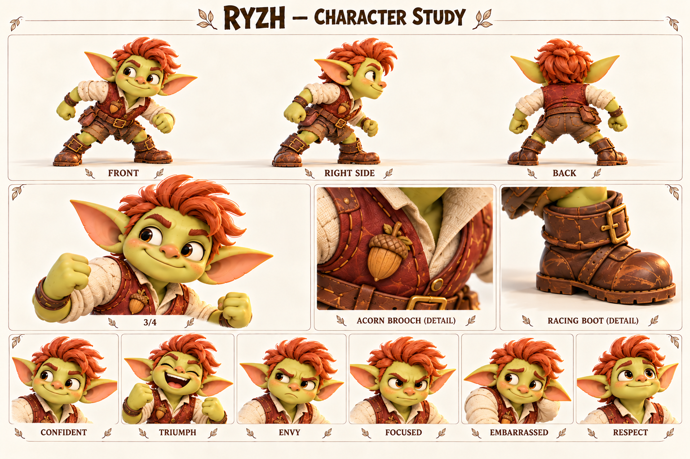

Концептуальные ракурсы и актёрские состояния. Это основа для следующего этапа моделирования; точные ортографические виды, скрытые сочленения и размеры уточняются отдельно.

### Образ

Огненно-рыжий зачёсанный гребень; кирпичный жилет; застёжка-жёлудь.

Палитра: Огненная медь / кирпичный / крем.

### История

Рыж рано понял, что быстро принесённая посылка вызывает улыбку, а выигранный забег собирает вокруг слушателей. Ему нравилось тренироваться: искать удобную постановку ноги, запоминать повороты, повторять неудачный участок. Застёжку-жёлудь он носит как личный знак, а не как доказательство звания. Его скорость заработана привычкой, а не особым происхождением.

Постепенно внимание после побед стало слишком важным. Если кто-то оказывался впереди, Рыж вспоминал мокрый камень, неудобный старт или «не совсем понятные правила». Он не обязательно обманывает сознательно: так легче не признать, что другой сегодня справился лучше. Тиш раздражает и привлекает его тем, что способен остановиться ради друга, даже когда до финиша совсем близко.

Будущая встреча должна дать Рыжу честный выбор: удержать преимущество или помочь тому, кто отстал. Его изменение убедительно, если он не перестанет любить гонки. Он может снова захотеть победить, но уже сумеет назвать чужой хороший ход и предложить реванш без оправданий. Дружба не отнимает его азарт — делает соревнование интересным для обоих.

### Мотивация и характер

**Чего хочет.** Быть признанным быстрым и умелым гонщиком.

**Чему нужно научиться.** Отделять собственную ценность от первого места.

**Чего боится.** Что после проигрыша никто не захочет слушать или звать его.

**Что мешает.** Ищет внешнее оправдание поражению и иногда превращает дружескую игру в проверку достоинства.

**На что опирается.** Тренированность, наблюдение за движением, настойчивость и способность увлечь соревнованием.

**Внутреннее противоречие.** Хорошо переносит усталость на тренировке, но плохо — одно спокойное поздравление победителю.

### Движение истории

1. Вызывает на гонку и ждёт признания.
2. Проигрывает или теряет преимущество.
3. Замечает чужое мастерство и собственную нечестную отговорку.
4. Просит реванш, сначала поздравив соперника.

### Отношения

- Тиш — соперник, способный показать другой смысл хорошего забега.
- Jo — не принимает оправданий, но отмечает реальное умение.
- Бум — помогает увидеть ценность неспешного действия.
- Пип — может восхищаться им; Рыж учится быть достойным примером без хвастовства.

### Характер общения

**Темп и ритм.** Быстро, пружинисто, с короткими вызовами и вопросами.

**Слова и построение фразы.** Спорим, успеешь, финиш, ещё раз, хороший ход. Спортивные наблюдения.

**Юмор.** Дружеское подначивание; после развития — самоирония о собственных отговорках.

**Под давлением.** Становится колким и торопливо объясняет, почему результат не считается.

**Как проявляет заботу.** Предлагает потренироваться вместе и делится конкретным приёмом.

**Чего избегать.** Не делать злодеем, хулиганом, мошенником по умолчанию или унижать проигравшего.

#### Примеры в сцене

**Вызов:** До поворота? Только без «я ещё не начал».

**Победа:** Хорошо шли! Ещё раз?

**Старая отговорка:** Я бы успел, если бы… Ладно. Ты был быстрее.

**Уважение:** На том камне ты здорово развернулся. Покажешь?

**Помощь:** Финиш подождёт. Давай руку.

**Реванш:** Поздравляю. А теперь у меня есть причина потренироваться.

### Эмоции и пластика

**CONFIDENT / Уверенность:** Приподнятый подбородок и открытая ухмылка.

**TRIUMPH / Триумф:** Радость всем лицом, без злорадства.

**ENVY / Зависть:** Взгляд в сторону победителя, улыбка пропадает.

**FOCUSED / Концентрация:** Подбородок ниже, глаза следят за опорой.

**EMBARRASSED / Стыд:** Взгляд вниз, рука к застёжке.

**RESPECT / Уважение:** Прямая искренняя улыбка, плечи свободны.

**Движение:** Перед стартом пружинит коленями, быстро проверяет дорожку глазами. После честного проигрыша остаётся на месте, не отворачивается сразу.

### Планы и ракурсы

**Общий план спереди:** Силуэт, лицо, одежда, положение ступней; без потери главных признаков.

**Боковой ракурс:** Глубина фигуры, профиль лица, предметы на ремнях и посадка одежды.

**Вид со спины:** Причёска, крепления, рюкзак либо панцирь; признаки не зеркалятся.

**Средний план в три четверти:** Лицо вместе с характерным жестом и позой корпуса.

**Крупные детали:** Материал и узнаваемые предметы; особенности лица, уха, руки или панциря.

**Шесть эмоциональных портретов:** Взгляд, брови, рот и положение головы; у существ также усики, крылья и поза.

### Будущая история

Гонка, где остановка ради другого оказывается важнее рекорда, а реванш остаётся дружеским обещанием.

### Ограничения канона

Взрослый силуэт, огненный гребень, целые уши. Не назначать врагом или участником текущих гонок без отдельной интеграции.

---

## Клоч / Kloch

Собирает блестящие вещи и учится замечать историю их владельцев.

Разговорчивая сказочная сорока-коллекционер; самостоятельный обитатель мира.

Внешность опирается на карту персонажей от 18 октября 2026. Развёрнутые биографии, мотивы и примеры общения — новая рабочая авторская версия. Будущие встречи не добавлены в действующий сценарий демо.

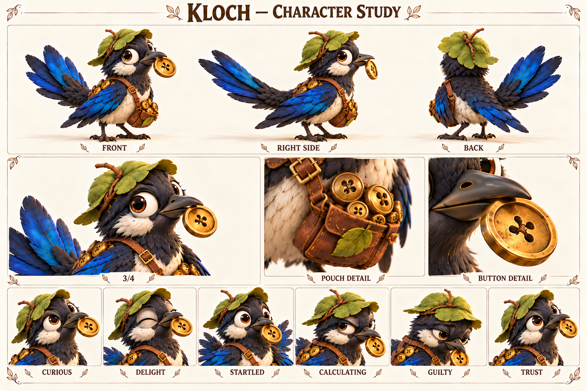

Концептуальные ракурсы и актёрские состояния. Это основа для следующего этапа моделирования; точные ортографические виды, скрытые сочленения и размеры уточняются отдельно.

### Образ

Чёрно-молочная сорока; кобальтовые крылья; листовая шапочка; пуговица; мешочек.

Палитра: Чернильный / молочный / кобальтовый.

### История

Клоч строит уют из маленьких находок: гладкой пуговицы, кусочка проволоки, светлой скорлупки. Ему нравится не цена вещи, а то, как она ловит свет и чем отличается от соседней. Он может долго выбирать место одной пуговице и гордиться удачной перестановкой. Листовая шапочка и мешочек делают его собирателем с собственным вкусом, а не случайной птицей у дороги.

Проблема появляется, когда Клоч считает оставленное без присмотра ничьим. Однажды он унёс красивую застёжку и только потом увидел, что без неё у хозяина не закрывается сумка. Вернуть находку оказалось труднее, чем взять: пришлось признать, что удовольствие было не только его. Рабочая биография оставляет место таким маленьким конфликтам; старую историю с линзой не возвращаем в нынешнее демо.

Будущая задача Клоча — устроить обмен, где у каждой находки есть понятное происхождение. Он всё ещё будет соблазняться блеском, но научится спрашивать и иногда приносить вещь обратно без награды. Особенно хороша сцена, в которой он замечает потерю раньше хозяина и сам предлагает поиск: его внимательность наконец работает не только на собственную коллекцию.

### Мотивация и характер

**Чего хочет.** Сделать самое красивое и уютное собрание маленьких сокровищ.

**Чему нужно научиться.** Понимать чужое владение и радоваться обмену, а не присвоению.

**Чего боится.** Остаться без запаса, красоты и места, которое считает своим.

**Что мешает.** Быстро придумывает удобное оправдание: «лежало — значит, свободно».

**На что опирается.** Наблюдательность, память на детали, изобретательность и умение находить потерянное.

**Внутреннее противоречие.** Помнит каждую царапинку на пуговице, но сначала забывает о человеке, которому она нужна.

### Движение истории

1. Забирает понравившуюся находку.
2. Видит её значение для хозяина.
3. Возвращает и честно называет свой поступок.
4. Сам предлагает обмен или помогает искать пропажу.

### Отношения

- Корень — знает цену маленьким деталям и может договориться об обмене.
- Тиш — задаёт прямой вопрос о происхождении находки.
- Фика — рисует коллекцию, не забирая её; это удивляет Клоча.
- Рута — будущий источник дорожных историй о разных пуговицах.

### Характер общения

**Темп и ритм.** Отрывисто, быстро; повторяет особенно понравившееся слово. Как сказочная птица может говорить короткими фразами.

**Слова и построение фразы.** Блестит, нашёл, моё, поменяемся, красивое. Позже появляется важное «твоё».

**Юмор.** Самодовольная точность о незначительной вещи и запоздалое понимание очевидного.

**Под давлением.** Тараторит оправдания, прячет находку под крыло.

**Как проявляет заботу.** Приносит подходящую мелочь и спрашивает, нужна ли она.

**Чего избегать.** Не делать злым вором, бесконечно жадным карикатурным торговцем или возвращать обязательную линзу.

#### Примеры в сцене

**Находка:** Круглая. Золотая. Почти солнце. Только пуговица.

**Отговорка:** Она лежала! Очень отдельно лежала.

**Вопрос:** Твоя? А почему ты без неё ходишь?

**Признание:** Взял без спроса. Вот. Целая.

**Обмен:** Мне синюю. Тебе вот эту. Согласен?

**Забота:** Ты потерял застёжку? Я запомнил, какая она.

### Эмоции и пластика

**CURIOUS / Любопытство:** Наклон головы и один глаз к предмету.

**DELIGHT / Восторг:** Перья слегка подняты, клюв приоткрыт.

**STARTLED / Испуг:** Корпус вытягивается, крылья прижаты.

**CALCULATING / Расчёт:** Взгляд переводится между двумя находками.

**GUILTY / Вина:** Голова ниже, предмет больше не спрятан.

**TRUST / Доверие:** Спокойная посадка и открытое предложение находки.

**Движение:** Птичьи быстрые повороты головы, два шага и остановка. Эмоции через веки, перья и посадку, без человеческих губ или дополнительных рук.

### Планы и ракурсы

**Общий план спереди:** Силуэт, лицо, одежда, положение ступней; без потери главных признаков.

**Боковой ракурс:** Глубина фигуры, профиль лица, предметы на ремнях и посадка одежды.

**Вид со спины:** Причёска, крепления, рюкзак либо панцирь; признаки не зеркалятся.

**Средний план в три четверти:** Лицо вместе с характерным жестом и позой корпуса.

**Крупные детали:** Материал и узнаваемые предметы; особенности лица, уха, руки или панциря.

**Шесть эмоциональных портретов:** Взгляд, брови, рот и положение головы; у существ также усики, крылья и поза.

### Будущая история

Честная ярмарка находок и история возвращённой застёжки.

### Ограничения канона

Две лапы, два крыла, клюв; чёрно-молочное оперение с кобальтом. Не назначать речь этой карточки уже встроенными игровыми репликами.

---

## Жук-коряжник / Bark

Живёт в собственном медленном ритме и может договориться с теми, кто этот ритм заметит.

Жук-коряжник, самостоятельный обитатель тропы; естественное препятствие, не злодей.

Внешность опирается на карту персонажей от 18 октября 2026. Развёрнутые биографии, мотивы и примеры общения — новая рабочая авторская версия. Будущие встречи не добавлены в действующий сценарий демо.

Концептуальные ракурсы и актёрские состояния. Это основа для следующего этапа моделирования; точные ортографические виды, скрытые сочленения и размеры уточняются отдельно.

### Образ

Кора на панцире; мох; янтарные глаза; шесть лап; лист во рту.

Палитра: Кора / мох / янтарь.

### История

Жук-коряжник выбирает влажную тень, мягкие листья и удобные места для отдыха. Его древесный панцирь с мхом похож на часть леса, поэтому спешащий путник иногда замечает его только тогда, когда «коряга» начинает двигаться. Он не охраняет дорогу и не строит ловушек: просто хорошие места для обеда часто совпадают с удобными местами для шага.

В рабочей истории после сильного дождя часть привычных листьев оказалась залита, и Жук перебрался ближе к деревенской тропе. Первые попытки прогнать его громкими командами не помогли. Фика заметила, что он поворачивается к свежему листу раньше, чем к шуму, а Шал показал, как оставить ему проход. Для жука это было не приручение, а понятное изменение пространства.

Будущие сцены могут строиться на взаимном приспособлении: жители перестают складывать вещи на его дорожке, а он привыкает обходить занятый настил. Он не становится послушным питомцем и не обязан помогать в ответ на кормление. Его небольшая драматическая дуга — от настороженного замирания к спокойному присутствию рядом. Игрок узнаёт, что не всякое препятствие имеет злой умысел.

### Мотивация и характер

**Чего хочет.** Найти пищу, тень и спокойную безопасную опору.

**Чему нужно научиться.** В поведенческом смысле — привыкнуть к предсказуемому соседству, сохраняя собственные границы.

**Чего боится.** Резкий шум, нависающее движение и отсутствие пути отступления.

**Что мешает.** Упрямо остаётся на удобном месте; это особенность поведения, не моральная вина.

**На что опирается.** Чувствительность к поверхности, устойчивость, терпение и запоминание знакомых маршрутов.

**Внутреннее противоречие.** Выглядит неподвижной корягой, но постоянно исследует пространство усиками.

### Движение истории

1. Замирает перед шумными путниками.
2. Получает свободный путь и время.
3. Сам выбирает движение.
4. В следующий раз узнаёт спокойное знакомое приближение.

### Отношения

- Фика — наблюдает и рисует, не тянет за лапы.
- Шал — понимает значение свободного прохода.
- Тиш — учится остановиться и посмотреть, чем занят жук.
- Пятнышко — другое существо; никакого родства или единой магической природы не закреплено.

### Характер общения

**Темп и ритм.** Невербальный персонаж: короткие щелчки, шорох лап и длинные спокойные паузы.

**Слова и построение фразы.** Слова не произносит. Значение передаётся усиками, остановкой, поворотом и дистанцией.

**Юмор.** Пауза перед неторопливым укусом листа в момент всеобщей спешки.

**Под давлением.** Замирает, опускает усики, прижимает лапы; затем ищет выход.

**Как проявляет заботу.** Узнаёт привычное спокойное присутствие, не изображает человеческую благодарственную речь.

**Чего избегать.** Не добавлять озвученные человеческие реплики, злобный оскал и автоматическое послушание за еду.

#### Примеры в сцене

**Приветствие · действие:** Поворачивает усики к знакомому шагу и продолжает жевать.

**Тревога · действие:** Замирает; лист остаётся в жвалах, усики уходят назад.

**Просьба о месте · действие:** Касается края предмета усиком и останавливается.

**Отказ · действие:** Плотнее ставит лапы и отворачивает голову.

**Доверие · действие:** Сам выходит из укрытия, когда ему оставили проход.

**Юмор · подпись карточки:** «Я тут ненадолго» — авторская подпись, не произнесённая реплика.

### Эмоции и пластика

**CONTENT / Довольство:** Полуприкрытые глаза, спокойные усики.

**DELIGHT / Удовольствие:** Взгляд оживляется при свежем листе.

**ALERT / Тревога:** Усики назад, тело ниже.

**STUBBORN / Упрямство:** Лапы устойчиво расставлены, жевание продолжается.

**PUZZLED / Недоумение:** Поочерёдно поворачивает усики к препятствию.

**TRUST / Доверие:** Тело свободнее, усики исследуют без резкого отдёргивания.

**Движение:** Шесть лап работают согласованно, панцирь имеет вес; эмоции через глаза, усики и высоту корпуса. Не прыгает как гоблин.

### Планы и ракурсы

**Общий план спереди:** Силуэт, лицо, одежда, положение ступней; без потери главных признаков.

**Боковой ракурс:** Глубина фигуры, профиль лица, предметы на ремнях и посадка одежды.

**Вид со спины:** Причёска, крепления, рюкзак либо панцирь; признаки не зеркалятся.

**Средний план в три четверти:** Лицо вместе с характерным жестом и позой корпуса.

**Крупные детали:** Материал и узнаваемые предметы; особенности лица, уха, руки или панциря.

**Шесть эмоциональных портретов:** Взгляд, брови, рот и положение головы; у существ также усики, крылья и поза.

### Будущая история

Небольшая история об общей тропе, где решение находится наблюдением и перестановкой вещей.

### Ограничения канона

Дерево и мох, шесть лап, два усика. Не превращать в каменную Пятнышко; карточные подписи не считать речью.

---

## Кусь / Kus

Исследует мир зубами и учится отпускать вещь, не боясь потерять связь.

Рабочий новый спутник Тиша; маленький кристальный дракончик, не умеющий летать.

Внешность опирается на карту персонажей от 18 октября 2026. Развёрнутые биографии, мотивы и примеры общения — новая рабочая авторская версия. Будущие встречи не добавлены в действующий сценарий демо.

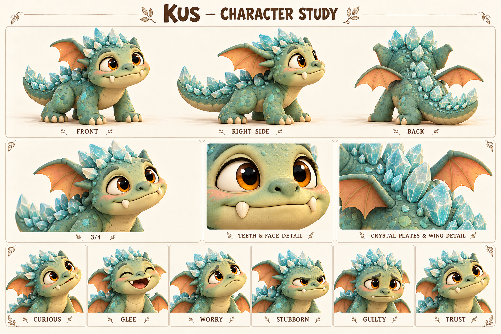

Концептуальные ракурсы и актёрские состояния. Это основа для следующего этапа моделирования; точные ортографические виды, скрытые сочленения и размеры уточняются отдельно.

### Образ

Четыре лапы; два заметных зуба; короткие крылья; округлые аквамариновые пластины.

Палитра: Шалфейная бирюза / крем / аквамарин.

### История

Кусь запоминает мир через фактуру: гладкая шишка, мягкий ремешок, прохладный камень. В рабочей версии первой встречи Тиш замечает его у корней, где тот пытается вытащить застрявший обрывок ткани. Вместо погони Тиш освобождает ткань и садится рядом. Дракончик возвращается сам — сначала к ремешку, потом к знакомому голосу. Это предложение для будущей сцены, а не уже показанное событие демо.

Его маленькие крылья помогают держать равновесие при прыжке, но не поднимают тело в воздух. Он может смотреть на птицу и пробовать повторить движение, после чего находить наземный путь. Эта особенность не требует истории болезни, проклятия или обязательного исцеления. Кристаллы на спине — часть тела; они не расходуются как ресурс и не превращают каждый жест в световой эффект.

Поначалу Кусь удерживает понравившуюся вещь, особенно когда волнуется: так проще сохранить рядом знакомое. Тиш учится предлагать обмен и давать время, а дракончик — отпускать без страха, что всё исчезнет. Со временем он сможет сам принести ремешок вместо того, чтобы утащить его. Происхождение следа укуса на ухе Тиша остаётся отдельной тайной: эта карточка не назначает Куся виновником.

### Мотивация и характер

**Чего хочет.** Исследовать новое и оставаться рядом со знакомым безопасным спутником.

**Чему нужно научиться.** Научиться доверять возвращению и отпускать предмет без тревоги.

**Чего боится.** Резкое отнятие находки, громкая погоня и потеря знакомого рядом.

**Что мешает.** Проверяет вещи зубами и крепче держится, когда его торопят.

**На что опирается.** Любопытство, настойчивость, чуткость к жестам и неожиданная изобретательность на земле.

**Внутреннее противоречие.** Выглядит маленьким грозным зубастиком, но сильнее всего нуждается в спокойном доверии.

### Движение истории

1. Хватает и удерживает знакомую вещь.
2. Получает спокойный обмен вместо погони.
3. Сам отпускает и остаётся рядом.
4. Приносит находку, чтобы разделить её со спутником.

### Отношения

- Тиш — основная будущая связь, построенная на предсказуемых действиях.
- Jo — помогает замечать сигналы и не торопить.
- Царап — шуршит интересно, но его лоскуты не становятся бесконечной игрушкой для укусов.
- Пятнышко — возможное тихое соседство; не обязаны получать одинаковое происхождение.

### Характер общения

**Темп и ритм.** Невербально: короткое любопытное урчание, сопение, писк и паузы.

**Слова и построение фразы.** Не произносит человеческие слова. Два зуба видны в характерной улыбке, но не мешают считывать эмоцию.

**Юмор.** Самоуверенная попытка тащить предмет, который больше его, и гордый взгляд после маленького успеха.

**Под давлением.** Прижимает крылья, хвост ближе к телу, крепче держит предмет.

**Как проявляет заботу.** Подходит сам, касается носом и кладёт находку рядом.

**Чего избегать.** Не делать агрессивной собакой, говорящим саркастичным помощником или обязательным виновником укуса Тиша.

#### Примеры в сцене

**Знакомство · действие:** Нюхает край сумки, смотрит на Тиша и ждёт.

**Просьба · действие:** Подталкивает шишку носом и коротко урчит.

**Тревога · действие:** Прижимает крылья и удерживает ремешок, не нападая.

**Обмен · действие:** Смотрит на предложенный предмет, разжимает зубы и остаётся.

**Доверие · действие:** Сам кладёт находку у ног Тиша.

**Подпись карточки:** «Крылья есть. Пешком быстрее» — подпись автора, не речь дракона.

### Эмоции и пластика

**CURIOUS / Любопытство:** Морда вперёд, глаза широко, крылья чуть приподняты.

**GLEE / Радость:** Открытая улыбка, хвост свободно движется.

**WORRY / Тревога:** Глаза ищут спутника, тело ниже.

**STUBBORN / Упрямство:** Лапы расставлены, взгляд исподлобья.

**GUILTY / Виноватость:** Для зрителя: голова ниже и предмет предложен обратно; не человеческая моральная речь.

**TRUST / Доверие:** Глаза мягкие, крылья расслаблены, сам сокращает дистанцию.

**Движение:** Четыре лапы, два крыла; бег с короткими прыжками, крылья работают для равновесия. Не зависает и не планирует над пропастью.

### Планы и ракурсы

**Общий план спереди:** Силуэт, лицо, одежда, положение ступней; без потери главных признаков.

**Боковой ракурс:** Глубина фигуры, профиль лица, предметы на ремнях и посадка одежды.

**Вид со спины:** Причёска, крепления, рюкзак либо панцирь; признаки не зеркалятся.

**Средний план в три четверти:** Лицо вместе с характерным жестом и позой корпуса.

**Крупные детали:** Материал и узнаваемые предметы; особенности лица, уха, руки или панциря.

**Шесть эмоциональных портретов:** Взгляд, брови, рот и положение головы; у существ также усики, крылья и поза.

### Будущая история

Первая встреча и маленькая история об обмене, где Тиш тоже учится терпению.

### Ограничения канона

Имя и биография рабочие. Не летает; не связан автоматически с рекой или укусом уха. Кристаллы округлые, без чрезмерного свечения.

---

## Пятнышко / Speckle

Стала тяжелее, но осталась той же любопытной подругой; заново учится доверять опоре.

Рабочая новая спутница Бума; живая каменная божья коровка после речного превращения.

Внешность опирается на карту персонажей от 18 октября 2026. Развёрнутые биографии, мотивы и примеры общения — новая рабочая авторская версия. Будущие встречи не добавлены в действующий сценарий демо.

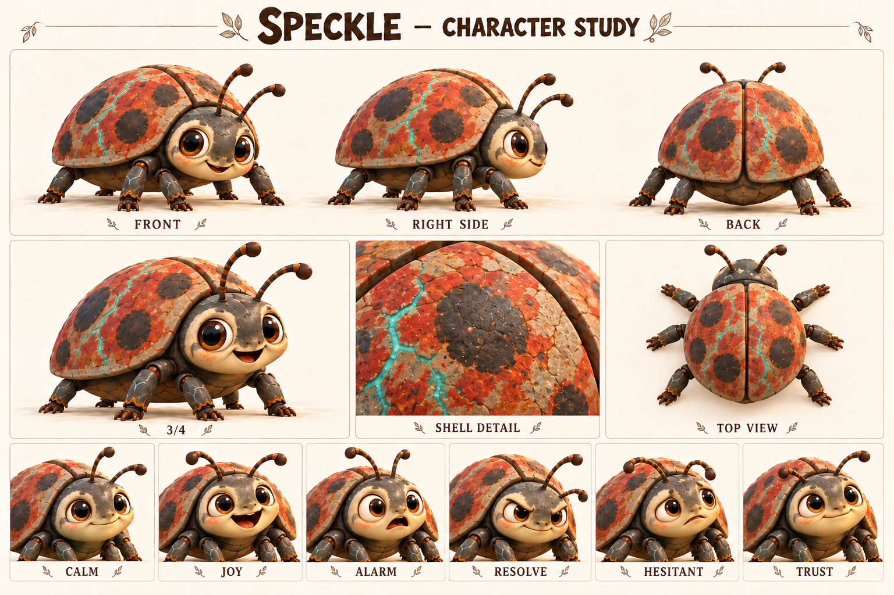

Концептуальные ракурсы и актёрские состояния. Это основа для следующего этапа моделирования; точные ортографические виды, скрытые сочленения и размеры уточняются отдельно.

### Образ

Каменные створки; тёмные круглые пятна; красно-охристые участки; шесть лап; два усика.

Палитра: Речной серый / ржаво-красный / бирюзовые прожилки.

### История

До реки Пятнышко была небольшой живой божьей коровкой с узнаваемыми пятнами на панцире. Бум привык встречать её возле влажного берега и оставлять ей пространство, пока нёс свои вещи. Их знакомство строилось на повторении спокойных встреч: одинаковый шаг, открытая ладонь, отсутствие погони. Это не делает её обязанной слушаться или служить ездовым животным.

В рабочей истории она соскользнула в волшебную реку. Вода начала увеличивать тело и менять панцирь на каменный. Бум лёг на берег, протянул правую руку и удерживал её, пока не вытащил на сушу. Превращение остановилось: глаза и сочленения остались живыми, лапы — подвижными. Минеральные прожилки на панцире и руке Бума показывают общую историю без поясняющей надписи.

После события привычные поверхности ведут себя иначе: тонкая ветка прогибается, старое укрытие тесно. Пятнышко сначала задерживается перед новым шагом и ищет знакомое прикосновение. Бум тоже приспосабливается к изменившейся руке, поэтому их восстановление взаимное. Будущая история может закончиться первым самостоятельным переходом по надёжному настилу: она выбирает идти сама, а Бум умеет ждать, не таща её за собой.

### Мотивация и характер

**Чего хочет.** Найти устойчивую опору, пищу и безопасное привычное пространство.

**Чему нужно научиться.** Освоить новый вес и снова самой выбирать движение.

**Чего боится.** Неустойчивая поверхность и звук воды, связанный с пережитым событием.

**Что мешает.** Может надолго замирать перед новым участком; это реакция на перемену, не упрёк в трусости.

**На что опирается.** Устойчивость, внимание к поверхности, память на знакомые сигналы и способность постепенно пробовать снова.

**Внутреннее противоречие.** Тяжёлый каменный панцирь скрывает осторожное живое существо.

### Движение истории

1. Задерживается у неизвестной опоры.
2. Исследует её усиками, пока Бум ждёт.
3. Делает один самостоятельный шаг.
4. Проходит участок своим темпом и возвращается к знакомой ладони.

### Отношения

- Бум — спаситель и друг; оба учатся новому телесному опыту.
- Шал — помогает подготовить надёжный подход к берегу.
- Рута и её обычная коровка — будущая встреча, показывающая вид до магического изменения.
- Bark — отдельный древесный жук, не её прежняя форма.

### Характер общения

**Темп и ритм.** Невербально: лёгкие щелчки, шорох сочленений и тяжёлые, но мягко поставленные шаги.

**Слова и построение фразы.** Не разговаривает. Усики, положение лап и дистанция передают намерение.

**Юмор.** Осторожная попытка поместиться в старое слишком маленькое укрытие без унижения персонажа.

**Под давлением.** Корпус ниже, усики отведены, передние лапы проверяют край.

**Как проявляет заботу.** Узнаёт Бума по привычному сигналу и сама касается его ладони усиком.

**Чего избегать.** Не давать человеческие монологи, не делать статуей, танком, грузовым инструментом или питомцем по обязанности.

#### Примеры в сцене

**Узнавание · действие:** Поворачивает усики к шагам Бума и выходит из тени.

**Сомнение · действие:** Проверяет настил передней лапой и снова ставит её назад.

**Просьба о паузе · действие:** Замирает; Бум останавливается вместе с ней.

**Попытка · действие:** Медленно переносит вес, пока остальные не двигаются.

**Доверие · действие:** Сама касается каменной ладони усиком.

**Подпись карточки:** «Друг тяжелее, дружба крепче» — авторская подпись.

### Эмоции и пластика

**CALM / Покой:** Усики свободны, корпус стоит ровно.

**JOY / Радость:** Глаза оживляются, усики направлены к знакомому.

**ALARM / Испуг:** Лапы ближе к корпусу, усики назад.

**RESOLVE / Решимость:** Взгляд на опору, передняя лапа медленно вытягивается.

**HESITANT / Неуверенность:** Остановленный перенос веса, усики исследуют край.

**TRUST / Доверие:** Самостоятельное приближение и расслабленные соединения.

**Движение:** Шесть согласованных лап; панцирь тяжёлый, глаза и усики живые. Камень не гнётся как резина, суставы остаются подвижными.

### Планы и ракурсы

**Общий план спереди:** Силуэт, лицо, одежда, положение ступней; без потери главных признаков.

**Боковой ракурс:** Глубина фигуры, профиль лица, предметы на ремнях и посадка одежды.

**Вид со спины:** Причёска, крепления, рюкзак либо панцирь; признаки не зеркалятся.

**Средний план в три четверти:** Лицо вместе с характерным жестом и позой корпуса.

**Крупные детали:** Материал и узнаваемые предметы; особенности лица, уха, руки или панциря.

**Шесть эмоциональных портретов:** Взгляд, брови, рот и положение головы; у существ также усики, крылья и поза.

### Будущая история

Первый переход после реки и встреча с обычной ездовой коровкой Руты.

### Ограничения канона

Имя рабочее. На текущем листе только after_river. До события меньше и обычная; после — увеличенная каменная. Не превращать автоматически в транспорт.

---

## Рута / Ruta

Умеет добираться куда угодно и учится оставаться там, где её ждут.

Рабочая будущая героиня — взрослая гоблинка-путешественница на обычной божьей коровке.

Внешность опирается на карту персонажей от 18 октября 2026. Развёрнутые биографии, мотивы и примеры общения — новая рабочая авторская версия. Будущие встречи не добавлены в действующий сценарий демо.

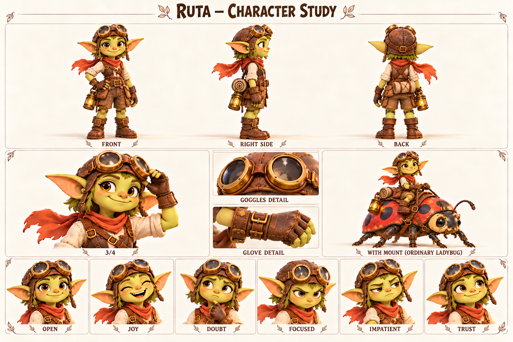

Концептуальные ракурсы и актёрские состояния. Это основа для следующего этапа моделирования; точные ортографические виды, скрытые сочленения и размеры уточняются отдельно.

### Образ

Дорожный шлем; латунные очки; короткие оливковые волосы; ржавый шарф; обычная красная наездная коровка.

Палитра: Кожа / латунь / олива / красный.

### История

Рута привыкла измерять путь остановками: сменить ремешок, проверить седло, дать коровке отдохнуть, спросить о состоянии следующего настила. Она не гонится за рекордами Рыжа; ей нравится чувство самостоятельности и возможность увидеть, что за поворотом. Шлем и очки защищают в дороге, а короткие волосы удобно убраны под ремешки. Обычная красная коровка — её спутница, с потребностями которой приходится считаться.

В рабочей биографии Рута возит небольшие посылки и новости между поселениями. Она хорошо помнит маршруты, но хуже — обещания вернуться без поручения. Если встреча становится слишком личной, легко находится причина проверить поклажу или отправиться до дождя. Так она сохраняет свободу, но иногда приезжает туда, где праздник уже закончился и никто не знал, стоит ли её ждать.

Будущая встреча с Бумом и Пятнышком начинается с узнавания вида: за камнем и изменившимся размером Рута замечает знакомые движения усиков. Она может поделиться дорожным опытом ухода, но не знает лекарства от речной магии. Её собственный поворот — задержаться ради друга и сообщить следующему получателю, что приедет позже. В конце она уезжает по своему выбору, оставив честное обещание новой встречи.

### Мотивация и характер

**Чего хочет.** Оставаться самостоятельной путешественницей и выполнять дорожные поручения.

**Чему нужно научиться.** Понять, что близость и договорённость не отнимают свободу.

**Чего боится.** Застрять в чужих ожиданиях или оказаться зависимой от одного места.

**Что мешает.** Избегает трудных разговоров удобным «мне пора» и обещает вернуться неопределённо.

**На что опирается.** Практичность, находчивость, опыт дороги и уважение к потребностям ездового животного.

**Внутреннее противоречие.** Легко доставляет чужие письма, но с трудом говорит, когда вернётся сама.

### Движение истории

1. Встречает компанию и собирается быстро уехать.
2. Замечает, что её опыт сейчас нужен.
3. Остаётся, честно меняя планы и уведомляя других.
4. Продолжает путь с конкретной договорённостью вернуться.

### Отношения

- Ездовая коровка — самостоятельное живое животное; имя пока не назначено.
- Бум и Пятнышко — будущая связь через знание обычных коровок и уважение к спасению.
- Jo — обмен наблюдениями о маршрутах, а не соперничество за одинаковую роль.
- Мира — умеет пригласить, а Рута учится отвечать определённо.

### Характер общения

**Темп и ритм.** Деловито и живо; быстро задаёт уточняющие вопросы.

**Слова и построение фразы.** Маршрут, ремень, привал, успеем, договорились, вернусь. Практические дорожные детали.

**Юмор.** Истории о небольших дорожных неудобствах, лёгкая самоирония.

**Под давлением.** Начинает собирать вещи во время разговора и сокращает ответы.

**Как проявляет заботу.** Проверяет снаряжение, предлагает конкретный способ облегчить путь.

**Чего избегать.** Не делать копией Jo, бесчувственной одиночкой, лётчицей из-за очков или всезнающей специалисткой по магии.

#### Примеры в сцене

**Знакомство:** Рута. Посылка сухая, дорога — не очень. Где здесь привал?

**О коровке:** Сначала она отдохнёт. Потом решим, сколько ещё идти.

**С Бумом:** Усики двигаются как у моей. Она тебя узнала.

**С Jo:** Покажи свой обход, я отмечу новый мосток.

**Честность:** Я хотела уехать, чтобы не отвечать. Останусь и отвечу.

**Обещание:** Вернусь после следующей доставки. Если задержусь — передам весть.

### Эмоции и пластика

**OPEN / Открытость:** Прямой взгляд, свободная улыбка.

**JOY / Радость:** Смеётся, рука отходит от ремня.

**DOUBT / Сомнение:** Бровь вверх, взгляд к маршруту.

**FOCUSED / Сосредоточенность:** Проверяет застёжку, губы чуть сжаты.

**IMPATIENT / Нетерпение:** Переступает, смотрит к выходу, рука уже на поклаже.

**TRUST / Доверие:** Откладывает вещи и полностью поворачивается к собеседнику.

**Движение:** Уверенно работает с ремнями и седлом; на земле имеет собственный полный силуэт. В близком разговоре перестаёт поправлять снаряжение.

### Планы и ракурсы

**Общий план спереди:** Силуэт, лицо, одежда, положение ступней; без потери главных признаков.

**Боковой ракурс:** Глубина фигуры, профиль лица, предметы на ремнях и посадка одежды.

**Вид со спины:** Причёска, крепления, рюкзак либо панцирь; признаки не зеркалятся.

**Средний план в три четверти:** Лицо вместе с характерным жестом и позой корпуса.

**Крупные детали:** Материал и узнаваемые предметы; особенности лица, уха, руки или панциря.

**Шесть эмоциональных портретов:** Взгляд, брови, рот и положение головы; у существ также усики, крылья и поза.

### Будущая история

Встреча на дороге, рассказ о реке и первое выполненное обещание вернуться без доставки.

### Ограничения канона

Имя и биография рабочие. Стоящий персонаж и ездовая коровка — разные модели. Коровка обычная красная, не Пятнышко. Уши целые.
