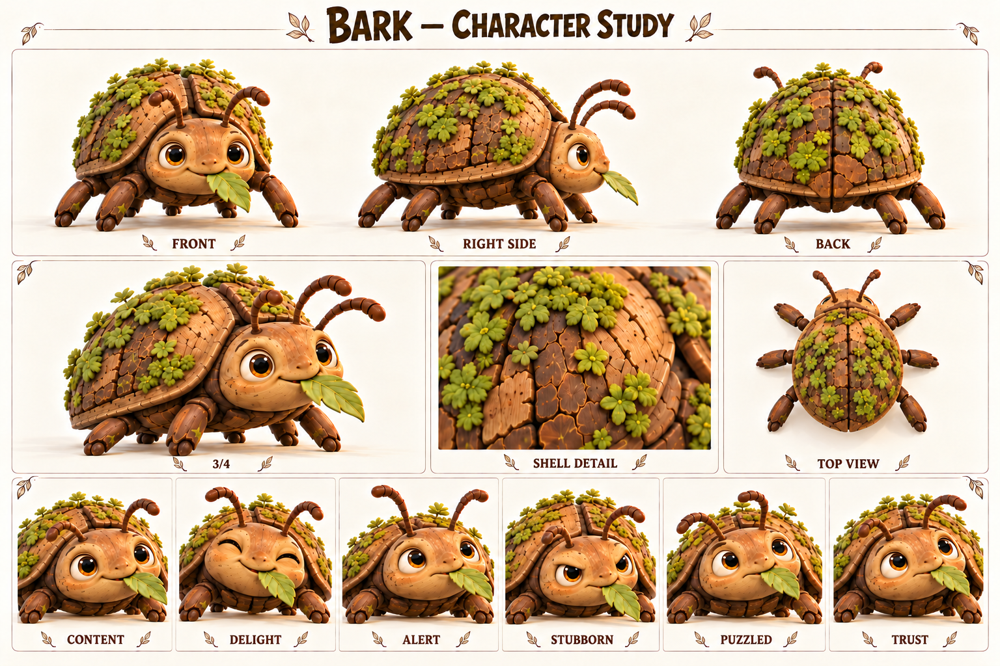

# Жук-коряжник / Bark

Живёт в собственном медленном ритме и может договориться с теми, кто этот ритм заметит.

Жук-коряжник, самостоятельный обитатель тропы; естественное препятствие, не злодей.

Внешность опирается на карту персонажей от 18 октября 2026. Развёрнутые биографии, мотивы и примеры общения — новая рабочая авторская версия. Будущие встречи не добавлены в действующий сценарий демо.

Концептуальные ракурсы и актёрские состояния. Это основа для следующего этапа моделирования; точные ортографические виды, скрытые сочленения и размеры уточняются отдельно.

## Образ

Кора на панцире; мох; янтарные глаза; шесть лап; лист во рту.

Палитра: Кора / мох / янтарь.

## История

Жук-коряжник выбирает влажную тень, мягкие листья и удобные места для отдыха. Его древесный панцирь с мхом похож на часть леса, поэтому спешащий путник иногда замечает его только тогда, когда «коряга» начинает двигаться. Он не охраняет дорогу и не строит ловушек: просто хорошие места для обеда часто совпадают с удобными местами для шага.

В рабочей истории после сильного дождя часть привычных листьев оказалась залита, и Жук перебрался ближе к деревенской тропе. Первые попытки прогнать его громкими командами не помогли. Фика заметила, что он поворачивается к свежему листу раньше, чем к шуму, а Шал показал, как оставить ему проход. Для жука это было не приручение, а понятное изменение пространства.

Будущие сцены могут строиться на взаимном приспособлении: жители перестают складывать вещи на его дорожке, а он привыкает обходить занятый настил. Он не становится послушным питомцем и не обязан помогать в ответ на кормление. Его небольшая драматическая дуга — от настороженного замирания к спокойному присутствию рядом. Игрок узнаёт, что не всякое препятствие имеет злой умысел.

## Мотивация и характер

**Чего хочет.** Найти пищу, тень и спокойную безопасную опору.

**Чему нужно научиться.** В поведенческом смысле — привыкнуть к предсказуемому соседству, сохраняя собственные границы.

**Чего боится.** Резкий шум, нависающее движение и отсутствие пути отступления.

**Что мешает.** Упрямо остаётся на удобном месте; это особенность поведения, не моральная вина.

**На что опирается.** Чувствительность к поверхности, устойчивость, терпение и запоминание знакомых маршрутов.

**Внутреннее противоречие.** Выглядит неподвижной корягой, но постоянно исследует пространство усиками.

## Движение истории

1. Замирает перед шумными путниками.
2. Получает свободный путь и время.
3. Сам выбирает движение.
4. В следующий раз узнаёт спокойное знакомое приближение.

## Отношения

- Фика — наблюдает и рисует, не тянет за лапы.
- Шал — понимает значение свободного прохода.
- Тиш — учится остановиться и посмотреть, чем занят жук.
- Пятнышко — другое существо; никакого родства или единой магической природы не закреплено.

## Характер общения

**Темп и ритм.** Невербальный персонаж: короткие щелчки, шорох лап и длинные спокойные паузы.

**Слова и построение фразы.** Слова не произносит. Значение передаётся усиками, остановкой, поворотом и дистанцией.

**Юмор.** Пауза перед неторопливым укусом листа в момент всеобщей спешки.

**Под давлением.** Замирает, опускает усики, прижимает лапы; затем ищет выход.

**Как проявляет заботу.** Узнаёт привычное спокойное присутствие, не изображает человеческую благодарственную речь.

**Чего избегать.** Не добавлять озвученные человеческие реплики, злобный оскал и автоматическое послушание за еду.

### Примеры в сцене

**Приветствие · действие:** Поворачивает усики к знакомому шагу и продолжает жевать.

**Тревога · действие:** Замирает; лист остаётся в жвалах, усики уходят назад.

**Просьба о месте · действие:** Касается края предмета усиком и останавливается.

**Отказ · действие:** Плотнее ставит лапы и отворачивает голову.

**Доверие · действие:** Сам выходит из укрытия, когда ему оставили проход.

**Юмор · подпись карточки:** «Я тут ненадолго» — авторская подпись, не произнесённая реплика.

## Эмоции и пластика

**CONTENT / Довольство:** Полуприкрытые глаза, спокойные усики.

**DELIGHT / Удовольствие:** Взгляд оживляется при свежем листе.

**ALERT / Тревога:** Усики назад, тело ниже.

**STUBBORN / Упрямство:** Лапы устойчиво расставлены, жевание продолжается.

**PUZZLED / Недоумение:** Поочерёдно поворачивает усики к препятствию.

**TRUST / Доверие:** Тело свободнее, усики исследуют без резкого отдёргивания.

**Движение:** Шесть лап работают согласованно, панцирь имеет вес; эмоции через глаза, усики и высоту корпуса. Не прыгает как гоблин.

## Планы и ракурсы

**Общий план спереди:** Силуэт, лицо, одежда, положение ступней; без потери главных признаков.

**Боковой ракурс:** Глубина фигуры, профиль лица, предметы на ремнях и посадка одежды.

**Вид со спины:** Причёска, крепления, рюкзак либо панцирь; признаки не зеркалятся.

**Средний план в три четверти:** Лицо вместе с характерным жестом и позой корпуса.

**Крупные детали:** Материал и узнаваемые предметы; особенности лица, уха, руки или панциря.

**Шесть эмоциональных портретов:** Взгляд, брови, рот и положение головы; у существ также усики, крылья и поза.

## Будущая история

Небольшая история об общей тропе, где решение находится наблюдением и перестановкой вещей.

## Ограничения канона

Дерево и мох, шесть лап, два усика. Не превращать в каменную Пятнышко; карточные подписи не считать речью.
