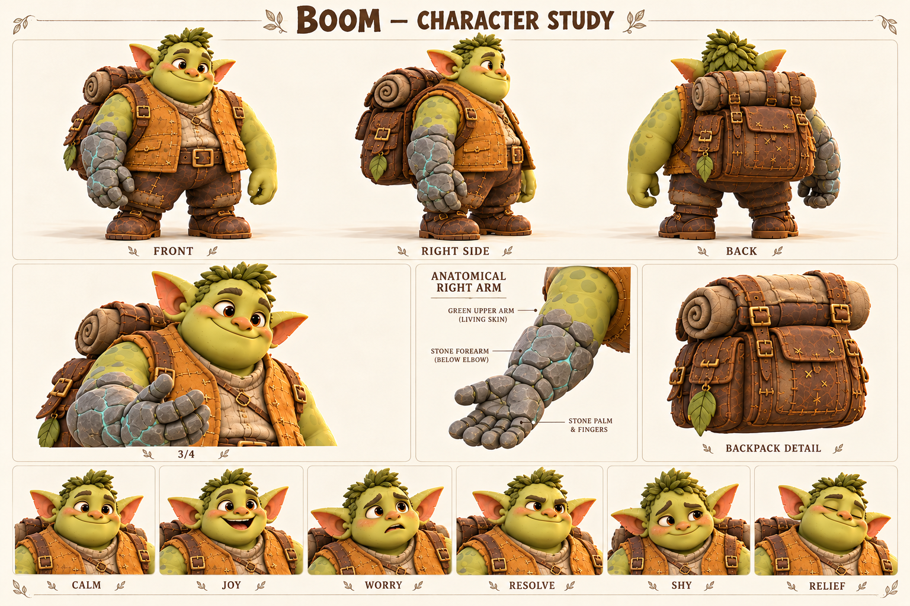

# Бум / Boom

Способен удержать тяжёлое и учится не держать все трудности в одиночку.

Взрослый широкоплечий друг команды; каменная правая кисть и предплечье — след спасения Пятнышка.

Внешность опирается на карту персонажей от 18 октября 2026. Развёрнутые биографии, мотивы и примеры общения — новая рабочая авторская версия. Будущие встречи не добавлены в действующий сценарий демо.

Концептуальные ракурсы и актёрские состояния. Это основа для следующего этапа моделирования; точные ортографические виды, скрытые сочленения и размеры уточняются отдельно.

## Образ

Широкий силуэт; охристый жилет; большой рюкзак; правая каменная кисть и предплечье.

Палитра: Охра / мох / речной серый / тонкие бирюзовые прожилки.

## История

Бум привык помогать там, где важны терпение и надёжность: перенести доски, придержать дверь мастерской, дождаться, пока застынет клей. Другие замечали его силу раньше аккуратности, поэтому он особенно берёг маленькие вещи. В рюкзаке всегда находилось место для мягкой подкладки, лишнего ремешка и чужой забытой чашки. Он не медленно думает — ему удобнее понятная задача, чем длинное объяснение сразу обо всём.

В рабочей будущей истории маленькая Пятнышко соскользнула в волшебную реку. Когда панцирь начал тяжелеть, Бум лёг на берег и потянулся правой рукой. Он не разжал ладонь, пока не вытащил её. Магия успела превратить кисть и предплечье в камень, но на суше изменение остановилось. Пятнышко осталась живой, а Бум — подвижным. Тонкие минеральные прожилки на обоих стали общей отметиной пережитого; история не требует изображать боль или насилие.

После этого ему пришлось заново привыкать к весу руки и осторожному захвату. Сначала он прятал неловкость, чтобы друзья не тревожились, но быстро понял: чашку проще попросить подержать, чем разбить из упрямства. В актуальном демо он доходит с командой до перевала; подробный рассказ о реке оставлен будущей главе. Его важный поступок не должен превращать каждую реплику в рассказ о собственном подвиге.

## Мотивация и характер

**Чего хочет.** Оставаться полезным другом и помочь Пятнышку освоиться с новым телом.

**Чему нужно научиться.** Принимать помощь без ощущения, что тем самым разочаровал остальных.

**Чего боится.** Нечаянно повредить хрупкое или стать для друзей только носильщиком.

**Что мешает.** Молча берёт слишком много и скрывает неудобство, пока оно не мешает делу.

**На что опирается.** Терпение, точность после тренировки, спокойствие и способность держать обещание.

**Внутреннее противоречие.** Самая тяжёлая рука в компании принадлежит самому бережному герою.

## Движение истории

1. Прячет затруднение за фразой «донесу».
2. Новая задача требует тонкости, а не силы.
3. Прямо просит помощи и учится новому хвату.
4. Поддерживает друга, не отказывая себе в поддержке.

## Отношения

- Пятнышко — спасённая подруга, а не трофей или транспорт по обязанности.
- Тиш — друг, которому Бум может честно сказать «мне неудобно».
- Jo — объясняет задачу по шагам, не разговаривая с ним как с ребёнком.
- Корень — помогает приспособить бытовые вещи; не обещает мгновенно снять магию.

## Характер общения

**Темп и ритм.** Неспешно, коротко и конкретно; пауза означает выбор слов, а не отсутствие мысли.

**Слова и построение фразы.** Держать, ровно, вместе, удобно, подожду. Один ясный вопрос за раз.

**Юмор.** Мягкая буквальность и контраст большого тела с маленькой заботой.

**Под давлением.** Говорит ещё короче; вместо громкого крика сначала обозначает действие.

**Как проявляет заботу.** Спрашивает, как удобнее помочь, а не решает за другого.

**Чего избегать.** Никаких шуток про глупость, детской речи, вечного голода и агрессии каменным кулаком.

### Примеры в сцене

**Предложение:** Подержать ровно или просто не отпускать?

**Пятнышку:** Я рядом. Давай сначала одну лапу.

**Ошибка:** Слишком крепко взял. Попробую мягче.

**Просьба:** Эту застёжку мне пока трудно. Поможешь?

**Опасность:** Отойди на сухое. Я держу.

**Юмор:** Цветок маленький. Значит, держать надо внимательнее.

## Эмоции и пластика

**CALM / Спокойствие:** Небольшая улыбка, открытая зелёная ладонь.

**JOY / Радость:** Щёки поднимаются, смех всем корпусом, без сильного раскачивания камеры.

**WORRY / Тревога:** Брови вверх у переносицы; каменная рука остаётся устойчивой.

**RESOLVE / Решимость:** Мягкость лица сохраняется, взгляд прямо на задачу.

**SHY / Смущение:** Взгляд в сторону, плечи чуть сведены, короткая улыбка.

**RELIEF / Облегчение:** Долгий выдох и осторожное расслабление пальцев.

**Движение:** Сначала переносит вес, потом шагает. Каменная рука имеет ощутимую инерцию, но не болтается без контроля; ладонь может удержать цветок. Рюкзак следует движению с небольшой задержкой.

## Планы и ракурсы

**Общий план спереди:** Силуэт, лицо, одежда, положение ступней; без потери главных признаков.

**Боковой ракурс:** Глубина фигуры, профиль лица, предметы на ремнях и посадка одежды.

**Вид со спины:** Причёска, крепления, рюкзак либо панцирь; признаки не зеркалятся.

**Средний план в три четверти:** Лицо вместе с характерным жестом и позой корпуса.

**Крупные детали:** Материал и узнаваемые предметы; особенности лица, уха, руки или панциря.

**Шесть эмоциональных портретов:** Взгляд, брови, рот и положение головы; у существ также усики, крылья и поза.

## Будущая история

Совместное освоение переправы с Пятнышком и просьба к Корню сделать удобную застёжку.

## Ограничения канона

После реки каменная только правая кисть и предплечье ниже локтя; до реки обе руки зелёные. Не зеркалить. Магическая рука не добавляет боевых правил автоматически.
