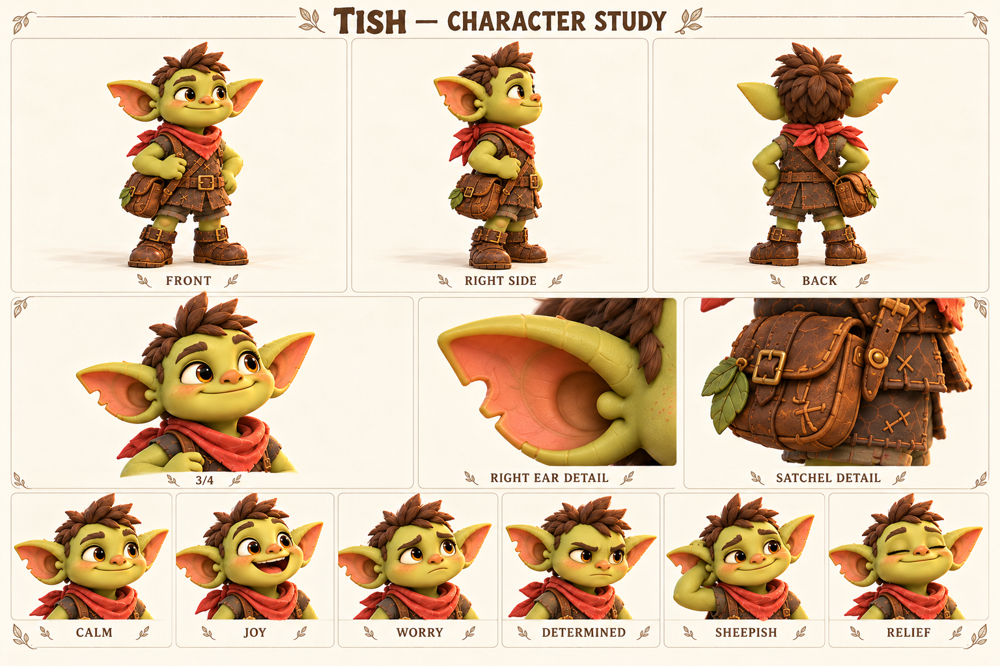

# Тиш / Tish

Всегда делает первый шаг и постепенно учится оставлять рядом место для чужого.

Главный герой; взрослый гоблин, дядя Пипа и Фики. Ведёт игрока через первые открытия.

Внешность опирается на карту персонажей от 18 октября 2026. Развёрнутые биографии, мотивы и примеры общения — новая рабочая авторская версия. Будущие встречи не добавлены в действующий сценарий демо.

Концептуальные ракурсы и актёрские состояния. Это основа для следующего этапа моделирования; точные ортографические виды, скрытые сочленения и размеры уточняются отдельно.

## Образ

Каштановый чуб; коралловый шарф; маленькая дорожная сумка.

Палитра: Коралл / тёплый зелёный / коричневая кожа.

## История

Тиш вырос среди коротких лесных троп, по которым жители носят письма, чинят мостки и возвращаются домой до темноты. Ещё подростком он охотно брался за маленькие поручения: доставить скобу Корню, придержать верёвку Шалу, найти укатившийся компас. Ему нравилось не столько приходить первым, сколько видеть, что после его появления кому-то стало легче. Со временем это превратилось в привычку обещать помощь раньше, чем оценивать свои силы.

Знакомство с Jo укрепило его любовь к дороге, но обнаружило разницу в подходах: Тиш уже шагает, пока она проверяет, выдержит ли настил. Они научились смеяться над этим, хотя он до сих пор иногда принимает её вопрос за сомнение в нём. С племянниками он старается выглядеть уверенным исследователем и потому особенно не любит признавать, что заблудился. Происхождение зажившего укуса на правом ухе остаётся открытой историей; он может отшутиться, но конкретного виновника пока нет.

В действующем демо Тиш занят починкой указателя, когда Царап зовёт его из кустов. Путь начинается с небольшого отклонения от дела, а не с великой миссии. Полная тропа, разрыв и дружеские гонки постепенно показывают ему, что движение вперёд не всегда означает спешку. Будущая дружба с Кусем продолжит эту тему: спутник требует внимания, которое нельзя заменить командой «скорее».

## Мотивация и характер

**Чего хочет.** Самостоятельно довести начатое дело до конца и доказать близким, что на него можно положиться.

**Чему нужно научиться.** Понять, что надёжность включает просьбу о помощи, остановку и признание ошибки.

**Чего боится.** Подвести тех, кто поверил его уверенному «я справлюсь».

**Что мешает.** Обещает лишнее, торопится закрыть проблему действием и иногда не дослушивает.

**На что опирается.** Быстро замечает чужую нужду, не прячется после промаха и возвращается исправлять последствия.

**Внутреннее противоречие.** Смел перед неизвестной дорогой, но смущается перед простым «мне нужна помощь».

## Движение истории

1. Берётся за всё и показывает уверенность.
2. Встречает задачу, которую спешка усложняет.
3. Спрашивает Jo или друга и принимает чужой способ.
4. Сам предлагает идти вместе, даже если так медленнее.

## Отношения

- Jo — равноправная близкая спутница; он учится слышать её без соревнования за правоту.
- Бум — друг, рядом с которым можно не изображать сильнейшего.
- Царап — неожиданное приглашение в приключение и зеркало его азарта.
- Пип и Фика — дети, перед которыми он учится показывать честный пример.
- Кусь — будущий спутник; факт укуса уха к нему не привязывается.

## Характер общения

**Темп и ритм.** Живо, короткими законченными фразами; перед признанием ошибки появляется небольшая пауза.

**Слова и построение фразы.** Шаг, рядом, держу, попробуем, сейчас. Конкретные действия вместо громких обещаний судьбы.

**Юмор.** Добродушная самоирония и маленькое преувеличение собственной готовности.

**Под давлением.** Начинает говорить быстрее и раздавать указания; взросление слышно, когда он останавливается и задаёт вопрос.

**Как проявляет заботу.** Предлагает понятное действие: подержать, подождать, пойти вместе.

**Чего избегать.** Не превращать в вечного хвастуна, командира или безошибочного избранного.

### Примеры в сцене

**Знакомство:** Я Тиш. Указатель почти готов. А ты давно в этих кустах?

**Ошибка:** Я поторопился. Давай посмотрим ещё раз.

**Поддержка:** Не спеши. Я здесь, камень никуда не уйдёт.

**С Jo:** Ты уже всё проверила? Конечно проверила. Показывай.

**С детьми:** Компас важный. Но ваша находка важнее: что вы заметили?

**Признание:** Одному у меня не выходит. Поможешь?

## Эмоции и пластика

**CALM / Спокойствие:** Мягкая улыбка, свободные плечи; ищет собеседника взглядом.

**JOY / Радость:** Глаза раскрываются, улыбка открытая, корпус подаётся вперёд.

**WORRY / Тревога:** Внутренние края бровей вверх, рука сжимает ремень сумки.

**DETERMINED / Решимость:** Брови собраны, устойчивые ступни, без агрессивного оскала.

**SHEEPISH / Смущение:** Почёсывает затылок, улыбка неровная, на секунду отводит взгляд.

**RELIEF / Облегчение:** Выдох, плечи опускаются, глаза почти закрыты.

**Движение:** В покое переносит вес с пятки на носок; перед шагом подаётся вперёд, после удачного прыжка сначала ищет глазами друга. Ухо не используется как подвижная шутка в каждой сцене.

## Планы и ракурсы

**Общий план спереди:** Силуэт, лицо, одежда, положение ступней; без потери главных признаков.

**Боковой ракурс:** Глубина фигуры, профиль лица, предметы на ремнях и посадка одежды.

**Вид со спины:** Причёска, крепления, рюкзак либо панцирь; признаки не зеркалятся.

**Средний план в три четверти:** Лицо вместе с характерным жестом и позой корпуса.

**Крупные детали:** Материал и узнаваемые предметы; особенности лица, уха, руки или панциря.

**Шесть эмоциональных портретов:** Взгляд, брови, рот и положение головы; у существ также усики, крылья и поза.

## Будущая история

История о поручении, которое он не сможет выполнить один; происхождение укуса раскрывать отдельным решением.

## Ограничения канона

Не возвращать в демо старый сюжет возврата линзы. Не менять сторону укуса, не приписывать его Кусю, не зеркалить портрет.
