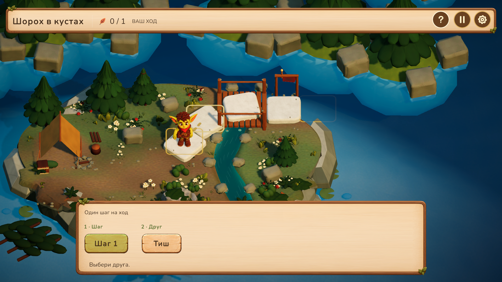

# Техническое задание на доработку карты Glimblehop

Дата: 21 октября 2026. Адресат: художник окружения и дизайнер игровых экранов.

Поднять качество игровой лесной диорамы до уровня новых персонажей и связать её с иллюстрированной картой главы. Сохранить тёплый, объёмный сказочный лес и существующий деревянный интерфейс. Главный результат — читаемое игровое пространство, в котором Тиш и друзья выглядят частью мира, а маршрут понятен без объяснений.

## 1. Объём работы и приоритеты

| Приоритет | Экран | Результат |
|---|---|---|
| P0 | Игровая диорама | Композиция, материалы, свет, плиты, выход, окружение и место для героев и диалогов |
| P0 | Первый уровень | Камера ближе к Тишу; виден оставшийся путь с пятой плиты; предыдущие четыре плиты отсутствуют |
| P1 | Карта главы с шестью уровнями | Более ясная иерархия, состояния узлов, маршрут и согласованность с игровой диорамой |
| P1 | Адаптация | Отдельно продуманные горизонтальная и вертикальная композиции, варианты для маленького экрана |

Не добавлять новые игровые правила, развилки, награды или элементы магазина. Образ персонажей уже утверждён. Одежда Лумы и её варианты — отдельная отложенная задача.

## 2. Что сохранить

- Лес, реку, камень с тёплыми светлыми поверхностями, мох, дерево и ткань как общую материальную основу.
- Существующий объёмный деревянный интерфейс с зелёными акцентами. Плоская замена стиля не требуется.
- На карте главы остаётся текущий двумерный Тиш с бегом и остановками. В игровом поле — новые 3D-герои и перемещение прыжками.
- У Тиша след укуса на его анатомически правом ухе. У остальных гоблинов оба уха целые. Лица, пропорции и индивидуальные признаки не переосмысливать.
- Шесть узлов карты главы и восемь логических плит игрового поля. Перенумерация плит и изменение расстояний прыжка не входят в художественную задачу.

## 3. Игровая диорама

### Композиция и читаемость

Приоритет внимания: герой → доступный шаг и место приземления → выход → окружение. Силуэты героев должны отделяться от земли и листвы без чрезмерного контура или постоянного свечения. За головой и руками оставлять спокойные по контрасту участки. Крупные деревья и камни использовать для рамки кадра; игровую дорожку не перекрывать ветками, кустами и передним планом.

Сейчас плотная иллюстрация карты главы и более простая игровая диорама воспринимаются как разный уровень проработки. Перенести в диораму крупные, узнаваемые формы леса и качество материалов. Не компенсировать разницу россыпью мелких цветов и декалей. Избегать видимых одинаковых повторов деревьев, гранёных берегов с одинаковым ритмом и стыков земли с водой.

Плиты должны иметь общий материал и масштаб, но различаться силуэтом, сколами и расположением мха. Верхняя площадка остаётся достаточно спокойной для подсветки и ног героя. Камень должен быть тяжёлым, с понятной толщиной и контактом с землёй. Следить за сопряжением высоких плит с ландшафтом: герой стоит на поверхности, а плита не висит над пустотой.

Выход обозначить предметом мира — столбиками с тканью, небольшим знаком или аккуратным огоньком. Предложить один основной вариант в существующем стиле. Он должен читаться как цель и отличаться от декоративных ворот, при этом не требовать большой надписи. Не вводить новую интерактивность.

### Материалы и свет

Утвердить общую палитру: тёплый известняк, охристая земля, лесная зелень, прохладная вода и небольшие янтарные акценты. Яркость окружения должна поддерживать кожу и красный шарф Тиша, волосы Лумы, каменную руку Бума и лоскуты Царапа. Не запекать сильный солнечный блик или чёрную тень в albedo, если они конфликтуют с освещением Unity.

Свет — мягкое тёплое солнце и сдержанный прохладный заполняющий свет. Нужны читаемый объём, контактные тени под ногами и мягкая глубина заднего плана. Без сильного bloom и размытия игровой дорожки. Цвет портретов уже настроен отдельно; их свет не менять ради окружения.

Вода должна иметь цельный берег, различимое направление течения и спокойный уровень детализации. Пена — у камня и перепада высот, а не равномерно по всей реке. Растительность собирать группами разного масштаба; освободить пространство вокруг доступных плит.

### Визуальные ориентиры шести уровней

Это небольшие акценты одной лесной локации, а не шесть новых биомов. Их точное расположение согласовать с существующим полем и камерой.

| Уровень | Сюжет | Предлагаемый ориентир |
|---|---|---|
| 1 | Шорох в кустах | Куст, из-за которого зовёт Царап, и место недавнего занятия Тиша; перед героем оставшийся участок пути |
| 2 | По лесной тропе | Полный маршрут через лесную поляну; ясное направление от начала к выходу |
| 3 | Треснувшая плита | Хорошо видимая трещина и нарушение целостности поверхности; однозначно читается опасность приземления |
| 4 | Перегонки с Царапом | Просторная поляна и свободные силуэты обоих участников; ощущение игры и движения |
| 5 | Кто быстрее, Лума? | Более мягкий речной или цветочный акцент; то же правило читаемости двух героев |
| 6 | Огонёк за перевалом | Небольшой тёплый огонёк у дальней цели и простор для трёх персонажей |

## 4. Первый уровень и камера

Тиш начинает на клетке с индексом 4 — это пятая из восьми плит. Перед ним остаются плиты 4–7 и выход. Плиты 0–3 и связанный именно с ними декоративный обвес нужно скрыть с первого открытого кадра. Они не должны исчезать на глазах или оставлять висящие сколы. На освободившемся месте допустима обычная лесная земля и растительность; это не провал и не новая игровая пропасть.

В Unity заложен стартовый ориентир увеличения героя примерно на 15% относительно полного маршрута. Кадр смещён к оставшемуся участку. При художественной проверке обеспечить видимость Тиша, всех оставшихся мест приземления и выхода в свободной от интерфейса области. Не обрезать уши, вершину прыжка и поднятую руку. На узком экране читаемость важнее достижения точного процента зума.

Композицию проверить отдельно во время вступительного диалога, выбора шага, прыжка и завершения. Камера не должна пульсировать при смене текста, сбрасываться от клика или непреднамеренно приближаться при появлении подсказки. Со второго уровня полный маршрут сохраняется. Пройденные плиты не исчезают после каждого прыжка.

Текущая реализация начального кадра в Unity — база для художественной доработки:

## 5. Карта главы

Уточнить иерархию между Тишем, текущим узлом, маршрутом, названием главы, прогрессом и кнопкой продолжения. Большая верхняя табличка не должна подавлять карту. Уменьшить зрительный шум непосредственно за цифрами и иконками состояний.

Шесть узлов образуют одну последовательность. Каждый имеет четыре визуальных состояния: закрыт, доступен, выбран/нажат, пройден. Состояния различаются формой значка и светлотой, а не одним цветом. Закрытый узел остаётся частью мира. Пройденный знак не перекрывает цифру. Подсветка доступного узла спокойная и локальная. Не добавлять мерцающее кольцо вокруг всех камней.

Дорожка должна соединять узлы без ложных ответвлений. Мост и другие проходы в фоне не должны обещать альтернативный маршрут. Сохранить крупные ориентиры — реку, водопад, мост, дерево — и снизить плотность мелкой листвы в местах взаимодействия. Стиль иконок замка, галочки, стрелки и кнопки возврата: общий ракурс, толщина края, освещение и тень, соответствующие существующим дереву и камню.

Ноги Тиша привязаны к верхней площадке камня; контактная тень лежит под ним. На остановке персонаж не должен оказаться сбоку от узла. Слой героя остаётся выше верхней таблички там, где траектория их пересекает. Декоративные слои не перехватывают нажатия.

Исходный холст карты — 1672 × 941. Текущие центры узлов в нормализованных координатах от левого верхнего угла:

| Узел | X | Y |
|---|---:|---:|
| 1 | 0.145 | 0.650 |
| 2 | 0.320 | 0.470 |
| 3 | 0.465 | 0.565 |
| 4 | 0.660 | 0.465 |
| 5 | 0.565 | 0.265 |
| 6 | 0.785 | 0.270 |

Для новой композиции разрешено предложить изменение расположения, но передать отдельную таблицу центров узлов, точки опоры ног и кривые маршрута. В `Chapter1_MapDefinition.asset` координаты Y идут снизу вверх: при переносе использовать `1 − Y`. Нельзя поменять фон и оставить несовпадающие старые точки движения героя.

## 6. Адаптация и интерфейс

Показать макеты 1920 × 1080 и 1080 × 1920, а также уменьшенные проверки 1280 × 720, 720 × 1280, 640 × 360 и 360 × 640. Вертикальный вариант — отдельная композиция, а не обрезанный горизонтальный фон. Все узлы видимы или достигаются прокруткой; активность уровней определяется существующим прогрессом. Основные действия доступны, декоративные края допускают обрезку.

На узком экране допустим согласованный скролл карты; нельзя уменьшать весь интерфейс до нечитаемого размера. Целевые области нажатия — минимум 44 × 44 логических единицы. Важные числа и подписи остаются читаемыми на маленьком превью. Проверить русский и английский текст, длинное название главы, счётчик 6 / 6 и безопасные отступы устройств.

Подложки окон и кнопок масштабируются через подготовленный 9-slice только в нейтральной центральной части. Листья, углы рамки, винты, фигурные наконечники и иконки — отдельные элементы либо защищённые края. Их пропорции не растягиваются. Текст, цифры и значки состояния не запекать в фон. Для каждого элемента указать внутренние отступы и допустимый диапазон размеров.

## 7. Передача материалов

Сначала передать один связный вариант направления: общий план диорамы, близкий кадр первого уровня с Тишем, карта главы и вертикальная композиция. После выбора направления — финальные исходники и раздельные игровые ассеты.

Для игровой сцены нужны `.blend` с логичными коллекциями и FBX, совместимый с Unity. Слои: земля и берега, вода, игровые плиты по отдельности, обвес каждой плиты, выход, крупная растительность, мелкий декор. Названия `TrailCell_00`–`TrailCell_07` и точки поверхности сохранить; оригинальные координаты — в `FirstTrail8.asset`. Не объединять все плиты или всю сцену в один mesh. Пивоты, масштаб и трансформации не должны смещать поверхность приземления.

Материалы готовить для URP Lit, без Blender-only узлов. Передать Base Color, Normal, карты масок с описанием каналов и настройками импорта. Разрешение выбирать по размеру объекта на экране; повторяемые поверхности — общие материалы и атласы. До финального экспорта приложить статистику треугольников, материалов и текстур. Целевой бюджет согласовывается по измерению текущей WebGL-сцены; произвольный высокий лимит сейчас не вводится.

Для карты главы нужны редактируемый слоёный исходник и PNG RGBA с прозрачностью: фон без надписей и героя, узел, состояния, тени, значки, декоративные передние слои, маски воды и отдельные элементы для анимации. Передать 1×/2× где нужно, исходные пропорции, pivots, размеры, таблицу anchors и маршрут. Для масштабируемых рамок — границы 9-slice и отдельные листья. Проверить края на светлом и тёмном фоне; ореолов и нарисованной шахматной прозрачности быть не должно.

Для анимации окружения достаточно сдержанного движения воды, листвы и одного-двух акцентов. Всё должно останавливаться в режиме уменьшенного движения. Не двигать кликабельные узлы вместе с декоративной листвой и не менять масштаб камеры ради живости.

## 8. Критерии приёмки

1. На уменьшенном кадре за секунду находятся герой, следующий шаг и выход. На карте главы — доступный уровень и кнопка продолжения.
2. Герои и окружение согласованы по палитре, свету и детализации; персонажи не теряются среди листвы.
3. Ноги имеют контакт с поверхностью, нет висящих плит, обрезанных ушей и перекрытия важного силуэта декором.
4. Первый уровень показывает оставшийся маршрут без первых четырёх плит; уровни 2–6 сохраняют полный путь.
5. Кадр вмещает места приземления и выход при диалоге и открытом HUD; смена текста не вызывает скачков масштаба.
6. Цифры, подписи и состояния различимы в обоих языках и ориентациях. Листья, рамки и кнопки сохраняют пропорции.
7. Раздельные ассеты позволяют интеграцию без вырезания кнопок, текста и героя из цельной картинки.
8. В Unity сохранены восемь логических координат, маршруты прыжков, кликабельные области, прогресс и текущий 2D-герой карты главы.

## 9. Материалы проекта для работы

- Текущее игровое поле и диалоги: [кадры Unity](../../../../../Tripo3D/work/cast_v05/index.html).
- Пример текущей карты главы: [скриншот](../../Validation/TripoBridge/tish-map-integrated.png). На этом старом кадре другой способ показа Тиша; текущий 2D-спрайт брать из проекта.
- Сборка карты: `Assets/_Project/03_UI/Map/WoodlandMapView.cs`, `Assets/_Project/Resources/Map/WoodlandMap.uss`.
- Координаты и маршрут главы: `Assets/_Project/Resources/Map/Chapter1_MapDefinition.asset`, `Chapter1_WoodlandRoutes.asset`.
- Текущая графика карты: `Assets/_Project/07_Art/UI/GlimblehopMap/`, `docs/Art/Glimblehop-map-kit-v1/`.
- Текущий 2D-Тиш: `docs/Art/Glimblehop-map-hero-sprites-v1/`.
- Игровая диорама: `Assets/_Project/05_Gameplay_Data/Battle/Diorama/FirstTrail8.prefab` и `FirstTrail8.asset`.
- Модель окружения: `Assets/_Project/07_Art/FirstTrail/FirstTrailPolished.fbx`.
- Данные демо и начальная композиция: `docs/DemoRC/v0.2/levels.json`.

Перед отправкой новой графики приложить общий кадр, кадр первого уровня, крупные планы стыков плита/земля и берег/вода, лист иконок во всех состояниях и мобильные макеты. Передача ТЗ сама по себе не означает публикацию или замену всей графики в игре.
